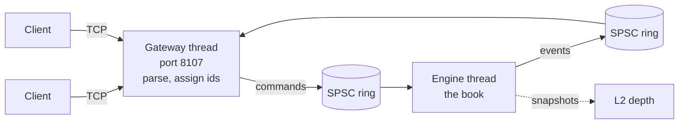

# Design

A limit order book for one instrument and the matching engine that runs it. Clients send commands (new orders and
cancels); the engine answers each command with a list of events (acceptances, rejections, trades, cancellations).
This document is the specification: the rules below are what the reference model implements literally and what the
real engine (day 2) must reproduce event for event.

## Goals and non-goals

Goals, in order:

1. **Correct by a checkable definition.** Every rule is written down here, implemented once in the simplest
   possible way (the reference model), and the fast engine is tested against that model on millions of random
   commands.
2. **Deterministic.** The same commands in the same order give the same events and the same book, on every
   platform and every run. No clocks, no randomness and no threads inside the engine.
3. **Fast on the hot path** (day 3): no allocation, no locks and no system calls while matching; latency measured
   as percentiles, not just averages.

Not goals: multiple instruments in one book (a router can own one book per symbol), auctions, stop orders,
fill-or-kill, iceberg orders, order modification (cancel and re-enter instead), self-trade prevention (the engine
has no notion of an account; the gateway could add it), fees, persistence, and negative prices.

## The model

- A **price** is a whole number of ticks and a **quantity** a whole number of lots, both `int64` (`types.hpp`).
  Integer prices make equality exact; converting to and from decimal prices is the gateway's job (day 4).
- The **book** has two sides. Bids (buy orders) are ordered best first by highest price; asks (sell orders) best
  first by lowest price. Orders at the same price form a **price level**, ordered by arrival.
- A **resting order** is what is left of a limit order that didn't fully trade: its id, side, price and remaining
  quantity, and its place in the queue.
- Only limit orders rest. IOC and market orders trade what they can at once and are then cancelled.

## Commands

| Command | Fields | Meaning |
|---|---|---|
| New limit order | id, side, quantity, price | Trade against the other side up to `price`; rest the remainder at `price`. |
| New IOC order | id, side, quantity, price | Trade up to `price`; cancel the remainder. |
| New market order | id, side, quantity | Trade at any price; cancel the remainder. A market order has no price (0). |
| Cancel | id | Remove the resting order `id` from the book. |

**Order ids** are assigned by whoever feeds the engine (the gateway, on day 4) and must **increase**: a new order's
id must be greater than every id the engine has accepted before. That makes a duplicate id impossible to accept
without the engine remembering every id it has seen (the check is one comparison), and it means an id is never
reused, so a late cancel can't hit a newer order that happened to get the same id. Clients keep their own ids; the
gateway maps them.

## Validation

A new order is checked in this order, and the first rule it breaks is the reason it is rejected:

1. `id-not-increasing`: its id is not greater than the last accepted id (ids start at 1).
2. `invalid-quantity`: its quantity is outside 1 to 10^9 lots.
3. `invalid-price`: a limit or IOC order's price is outside 1 to 10^9 ticks, or a market order has a price at all.

A cancel is rejected with `unknown-order` if no resting order has its id: it never existed, it was rejected, it was
fully filled, it was cancelled already, or it was an IOC or market order (they never rest).

**A rejected command changes nothing.** The book, and the last accepted id, are exactly as they were. (So a client
may resend a rejected order with the same id once it is fixed.)

The order of the checks is part of the specification, because two implementations must agree on the reason, not
only on the rejection.

## Matching

When a new order is accepted it is the **taker**; resting orders on the other side are **makers**.

1. **Crossing.** A buy crosses an ask whose price is at or below the buy's price; a sell crosses a bid at or above
   its price. A market order crosses every resting order on the other side.
2. **Price-time priority.** While the taker has quantity left and crosses the best resting order on the other
   side, it trades with that order. The best order is the one at the best price (the lowest ask, or the highest
   bid), and among orders at that price the one that arrived first.
3. **Trade price and quantity.** Each trade is at the **maker's price**, so a taker that crosses deeper than
   needed gets the better price, and is for the smaller of the two remaining quantities.
4. **Makers.** A maker that is filled leaves the book. A maker that is partly filled keeps its place in the
   queue, with its remaining quantity reduced.
5. **The remainder.** When the taker stops trading (it is filled, or the best maker no longer crosses, or the
   other side is empty), what is left of a limit order rests at its price, behind every order already at that
   price. What is left of an IOC or market order is cancelled.

A cancel removes the order from its level; the orders behind it move up, and nothing else changes.

### Events

Each command produces its events in this order:

| Command | Events |
|---|---|
| Rejected new order or cancel | `rejected id reason` |
| Accepted new order | `accepted id`; then one `trade` per maker it traded with, in the order it traded; then, for an IOC or market order with quantity left, `cancelled id remaining unfilled`. A limit order's rest is silent: the order is live until a `trade` fills it or a `cancelled` ends it. |
| Cancel of a resting order | `cancelled id remaining requested` |

A `trade` names the taker, the maker, the quantity and the price. One trade event covers both sides of the fill;
the gateway turns it into an execution report for each.

An example, with the book holding asks of 10 lots at 101 (order 1) and 10 at 102 (order 2):

```
> new 3 buy ioc 15 @ 102
accepted 3
trade 3 1 10 @ 101
trade 3 2 5 @ 102
= asks 102x5
```

Order 3 took all of order 1 at 101 (better than its limit of 102), then 5 lots of order 2 at 102. Order 2 keeps its
place with 5 lots left. Had order 3 been a limit order for 25, it would have taken all 20 lots and rested 5 at 102.

## Invariants

The tests check each of these, on the reference model now and on the engine from day 2.

- **I1, uncrossed.** After every command, if both sides are non-empty, the best bid is below the best ask. (Equal
  is impossible too: an order at the other side's best price would have traded.)
- **I2, priority.** Every trade is with the best resting order on the other side at that moment (rule 2).
- **I3, price limits.** A buy never trades above its price and a sell never below it; every trade is at the maker's
  price.
- **I4, conservation.** For every accepted order, its quantity equals what it traded (as taker or maker) plus what
  rests plus what was cancelled.
- **I5, a well-formed book.** Every resting order is from a limit order, has 1 or more lots left, and has a valid
  price; no price level is empty; no id rests twice.
- **I6, rejections change nothing** (Validation).
- **I7, determinism.** The same commands give the same events and the same book, on Linux and macOS, with GCC and
  Clang, in Debug and Release.

## The text format

Commands and events have a one-line text form, used by the scenario files in `tests/scenarios/` (day 1), the CLI,
and failing differential tests, which print the commands that reproduce them.

```
new <id> <buy|sell> limit <quantity> @ <price>
new <id> <buy|sell> ioc <quantity> @ <price>
new <id> <buy|sell> market <quantity>
cancel <id>

accepted <id>
rejected <id> <id-not-increasing|invalid-quantity|invalid-price|unknown-order>
trade <taker> <maker> <quantity> @ <price>
cancelled <id> <remaining> <requested|unfilled>
```

Every command the C++ types can hold has a text form that parses back to the same command, invalid ones included:
quantities and prices may be zero or negative (`new 4 buy limit 0 @ 100` is a valid line and an invalid order),
and a market order may carry `@ <price>`, which validation then rejects. Lines are lower case, single-spaced words.

A **scenario file** is a script with its expected results:

```
# Comment lines and blank lines are ignored.
# A command line: apply it.
> new 1 sell limit 10 @ 101
# The events it must produce: exactly these, in this order.
accepted 1
# This side's levels must now be exactly these, best first: price x total quantity.
= asks 101x10
# And this side must be empty.
= bids
```

A command's expected events are every event line up to the next command, so a command with no event lines must
produce no events. Depth checks are optional. The runner reports the file's line number of every mismatch.

## The reference model

`ReferenceBook` is the specification as code, written to be obviously correct rather than fast:

- Each side is a `std::vector` of resting orders in arrival order. A new order is appended; a filled or cancelled
  one is erased, which keeps the others in arrival order.
- To find the best maker, it scans the whole side for the best price and takes the first order at that price.
  That scan is rule 2, word for word.
- Depth is computed by sorting a copy.

That makes a fill O(n) in the number of resting orders, which is fine for an oracle: the differential tests run it
on books of hundreds to thousands of orders. It is never the thing that gets optimised.

## The engine (plan for days 2 and 3)

Day 2's engine is the conventional design, and day 3 makes it fast without changing a single event:

- Each side is a sorted map from price to level; each level is a FIFO list of orders; a hash map from order id to
  the order's node makes a cancel O(1). Matching takes the best level, walks its list from the front, and drops
  the level when it empties.
- Day 3: orders as nodes of intrusive doubly-linked lists, allocated from a pool sized up front, so the hot path
  never calls `new`; levels in a structure that keeps the best price cheap to find (most activity is near the top
  of the book); an open-addressing id table. Each change is measured before and after.
- Events go to a sink the caller provides, so the engine itself never allocates per event.

## Architecture (the plan for day 4)



One engine thread owns the book, so the book itself needs no locks. The gateway thread parses client messages,
assigns increasing order ids, and pushes commands through a single-producer single-consumer ring buffer (lock-free,
day 3); events come back through a second ring. Day 4 adds the gateway, a load generator, a synthetic market-data
replay and L2 snapshots.

## Testing

- **Unit tests** for the types, the text format and each component.
- **Scenario files** (`tests/scenarios/*.txt`), one or more per rule above, written by hand from this document, not
  recorded from the code. They run against the reference model now and the engine from day 2.
- **Invariant checks** (I1, I4, I5) after every command of long random runs.
- **Differential tests** (day 2): random command streams into the reference and the engine, comparing every event.
  The random streams come from a seeded generator with its own integer distribution, because the standard
  library's distributions are implementation-defined: `std::uniform_int_distribution` gives different numbers with
  libstdc++ (Linux) and libc++ (macOS), and the same seed must give the same stream on both CI runners.
- **Sanitizers.** CI runs every test under AddressSanitizer and UndefinedBehaviorSanitizer.
- **Benchmarks** (Google Benchmark): commands per second for the reference model now, as the baseline the engine
  has to beat; latency percentiles from day 3.

## Plan

| Day | Delivers |
|---|---|
| 1 | This design, the CMake scaffold, the types and text format, the reference model, scenario files, the random command generator and invariant checks, the benchmark harness, CI on Linux and macOS. |
| 2 | The matching engine (price levels, FIFO per level, trade events), differential tests against the reference. |
| 3 | Performance: intrusive lists, object pools, no allocation on the hot path; a lock-free SPSC ring; benchmarks (orders/s, latency percentiles). |
| 4 | Replay of a synthetic market-data stream, L2 snapshots, the TCP gateway (8107) with a load generator. |
| 5 | Latency histograms, README with results, WALKTHROUGH.md, v1.0.0. |
