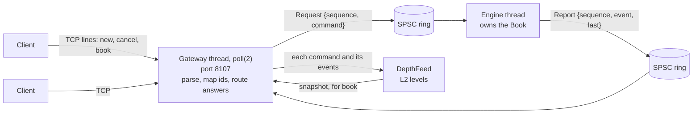

# Design

A limit order book for one instrument and the matching engine that runs it. Clients send commands (new orders and
cancels); the engine answers each command with a list of events (acceptances, rejections, trades, cancellations).
This document is the specification: the rules below are what the reference model implements literally and what the
engine (`Book`: built on day 2, rebuilt for speed on day 3) reproduces event for event. Day 4 put a TCP gateway in
front of it and an L2 market-data feed behind it.

## Goals and non-goals

Goals, in order:

1. **Correct by a checkable definition.** Every rule is written down here, implemented once in the simplest
   possible way (the reference model), and the fast engine is tested against that model on millions of random
   commands.
2. **Deterministic.** The same commands in the same order give the same events and the same book, on every
   platform and every run. No clocks, no randomness and no threads inside the engine.
3. **Fast on the hot path** (day 3): no allocation, no locks and no system calls while matching; latency measured
   as percentiles, not just averages.

Not goals: multiple instruments in one book (a router can own one book per symbol), auctions, stop orders,
fill-or-kill, iceberg orders, order modification (cancel and re-enter instead), self-trade prevention (the engine
has no notion of an account; the gateway could add it), fees, persistence, and negative prices.

## The model

- A **price** is a whole number of ticks and a **quantity** a whole number of lots, both `int64` (`types.hpp`).
  Integer prices make equality exact. The gateway's protocol is in ticks and lots too: converting to and from decimal
  prices is left to its clients.
- The **book** has two sides. Bids (buy orders) are ordered best first by highest price; asks (sell orders) best
  first by lowest price. Orders at the same price form a **price level**, ordered by arrival.
- A **resting order** is what is left of a limit order that didn't fully trade: its id, side, price and remaining
  quantity, and its place in the queue.
- Only limit orders rest. IOC and market orders trade what they can at once and are then cancelled.

## Commands

| Command | Fields | Meaning |
|---|---|---|
| New limit order | id, side, quantity, price | Trade against the other side up to `price`; rest the remainder at `price`. |
| New IOC order | id, side, quantity, price | Trade up to `price`; cancel the remainder. |
| New market order | id, side, quantity | Trade at any price; cancel the remainder. A market order has no price (0). |
| Cancel | id | Remove the resting order `id` from the book. |

**Order ids** are assigned by whoever feeds the engine (the gateway, since day 4) and must **increase**: a new order's
id must be greater than every id the engine has accepted before. That makes a duplicate id impossible to accept
without the engine remembering every id it has seen (the check is one comparison), and it means an id is never
reused, so a late cancel can't hit a newer order that happened to get the same id. Clients keep their own ids; the
gateway maps them.

## Validation

A new order is checked in this order, and the first rule it breaks is the reason it is rejected:

1. `id-not-increasing`: its id is not greater than the last accepted id (ids start at 1).
2. `invalid-quantity`: its quantity is outside 1 to 10^9 lots.
3. `invalid-price`: a limit or IOC order's price is outside 1 to 10^9 ticks, or a market order has a price other
   than 0 (0 is no price).

A cancel is rejected with `unknown-order` if no resting order has its id: it never existed, it was rejected, it was
fully filled, it was cancelled already, or it was an IOC or market order (they never rest).

**A rejected command changes nothing.** The book, and the last accepted id, are exactly as they were. (So a client
may resend a rejected order with the same id once it is fixed.)

The order of the checks is part of the specification, because two implementations must agree on the reason, not
only on the rejection.

## Matching

When a new order is accepted it is the **taker**; resting orders on the other side are **makers**.

1. **Crossing.** A buy crosses an ask whose price is at or below the buy's price; a sell crosses a bid at or above
   its price. A market order crosses every resting order on the other side.
2. **Price-time priority.** While the taker has quantity left and crosses the best resting order on the other
   side, it trades with that order. The best order is the one at the best price (the lowest ask, or the highest
   bid), and among orders at that price the one that arrived first.
3. **Trade price and quantity.** Each trade is at the **maker's price**, so a taker that crosses deeper than
   needed gets the better price, and is for the smaller of the two remaining quantities.
4. **Makers.** A maker that is filled leaves the book. A maker that is partly filled keeps its place in the
   queue, with its remaining quantity reduced.
5. **The remainder.** When the taker stops trading (it is filled, or the best maker no longer crosses, or the
   other side is empty), what is left of a limit order rests at its price, behind every order already at that
   price. What is left of an IOC or market order is cancelled.

A cancel removes the order from its level; the orders behind it move up, and nothing else changes.

### Events

Each command produces its events in this order:

| Command | Events |
|---|---|
| Rejected new order or cancel | `rejected id reason` |
| Accepted new order | `accepted id`; then one `trade` per maker it traded with, in the order it traded; then, for an IOC or market order with quantity left, `cancelled id remaining unfilled`. A limit order's rest is silent: the order is live until a `trade` fills it or a `cancelled` ends it. |
| Cancel of a resting order | `cancelled id remaining requested` |

A `trade` names the taker, the maker, the quantity and the price. One trade event covers both sides of the fill;
the gateway turns it into an execution report for each.

An example, with the book holding asks of 10 lots at 101 (order 1) and 10 at 102 (order 2):

```
> new 3 buy ioc 15 @ 102
accepted 3
trade 3 1 10 @ 101
trade 3 2 5 @ 102
= asks 102x5
```

Order 3 took all of order 1 at 101 (better than its limit of 102), then 5 lots of order 2 at 102. Order 2 keeps its
place with 5 lots left. Had order 3 been a limit order for 25, it would have taken all 20 lots and rested 5 at 102.

## Invariants

The tests check each of these on both books: the reference model, and the engine (directly, and through the
differential tests, which compare the two books' events after every command and their states at checkpoints).

- **I1, uncrossed.** After every command, if both sides are non-empty, the best bid is below the best ask. (Equal
  is impossible too: an order at the other side's best price would have traded.)
- **I2, priority.** Every trade is with the best resting order on the other side at that moment (rule 2).
- **I3, price limits.** A buy never trades above its price and a sell never below it; every trade is at the maker's
  price.
- **I4, conservation.** For every accepted order, its quantity equals what it traded (as taker or maker) plus what
  rests plus what was cancelled.
- **I5, a well-formed book.** Every resting order is from a limit order, has 1 or more lots left, and has a valid
  price; no price level is empty; no id rests twice.
- **I6, rejections change nothing** (Validation).
- **I7, determinism.** The same commands give the same events and the same book, on Linux and macOS, with GCC and
  Clang, in Debug and Release. Tested by pinned hashes of a random stream and of the reference model's events and
  book on it, which every CI job must reproduce; the engine must give the same hash of its events and book. (The
  engine never iterates its hash index, whose order differs between standard libraries; only its maps and lists,
  whose order is the book's.)

## The text format

Commands and events have a one-line text form, used by the scenario files in `tests/scenarios/` (day 1), the CLI,
and failing differential tests, which print the commands that reproduce them.

```
new <id> <buy|sell> limit <quantity> @ <price>
new <id> <buy|sell> ioc <quantity> @ <price>
new <id> <buy|sell> market <quantity>
cancel <id>

accepted <id>
rejected <id> <id-not-increasing|invalid-quantity|invalid-price|unknown-order>
trade <taker> <maker> <quantity> @ <price>
cancelled <id> <remaining> <requested|unfilled>
```

Every command whose side and type are named values has a text form that parses back to the same command, invalid
ones included: quantities and prices may be zero or negative (`new 4 buy limit 0 @ 100` is a valid line and an
invalid order), and a market order may carry a nonzero `@ <price>`, which validation then rejects (`@ 0` is the same
command as no price). Words are lower case and separated by spaces or tabs; the formatter writes single spaces. The
book doesn't check that a side or type is a named value: commands come from the parser, which makes only those, and
the gateway reads its clients' lines with the same parser.

A **scenario file** is a script with its expected results:

```
# Comment lines and blank lines are ignored.
# A command line: apply it.
> new 1 sell limit 10 @ 101
# The events it must produce: exactly these, in this order.
accepted 1
# This side's levels must now be exactly these, best first: price x total quantity.
= asks 101x10
# And this side must be empty.
= bids
# The rest of the book's state: a side's orders in priority order (id:price x remaining), its best price (or none),
# the number of orders resting on both sides, and the last accepted id.
= orders asks 1:101x10
= best asks 101
= best bids none
= resting 1
= last-accepted 1
```

A command's expected events are every event line up to the next command, so a command with no event lines must
produce no events. Depth and state checks are optional, and come after the step's events. The hand-written files use
depth checks; the differential harness ends each file it writes with every state check, so that a file pins
everything the harness compares. The runner stops at the first step that doesn't match and reports what was
expected, what happened, and the line.

## The reference model

`ReferenceBook` is the specification as code, written to be obviously correct rather than fast:

- Each side is a `std::vector` of resting orders in arrival order. A new order is appended; a filled or cancelled
  one is erased, which keeps the others in arrival order.
- To find the best maker, it scans the whole side for the best price and takes the first order at that price.
  That scan is rule 2, word for word.
- Depth is computed by sorting a copy.

That makes a fill O(n) in the number of resting orders, which is fine for an oracle: the differential tests run it
on books of hundreds to thousands of orders. It is never the thing that gets optimised.

## The engine

The engine is `Book` (`include/orderbook/book.hpp`). Day 2 built the conventional design; day 3 rebuilt it for speed
without changing a single event, and kept day 2's as `MapBook` in the test kit, so the two are measured in the same
runs and the rules run on both.

- **Day 2 (`MapBook`).** Each side a `std::map` from price to level, ordered best first by one comparator type for
  both sides (`BetterPrice{side}`); each level a `std::list` of its orders, oldest first, with its total quantity kept
  as orders fill and cancel; a `std::unordered_map` from order id to the order's level and list node, so a cancel is
  O(1) on average. Correct and flat in the book's size (about 20 M commands/s from 7 resting orders to 5,410), but
  every order that rests allocates a list node and a hash node (and a new level a map node), and matching follows
  pointers through all three: at 7 resting orders it was 4 times slower than the reference model's vector scan.
- **Day 3 (`Book`), as built:**
  - **The pool.** Every resting order is a node in one `std::vector<OrderNode>` (id, remaining, price, side, prev,
    next: 40 bytes). A node an order leaves goes on a free list threaded through `next`, and the next order to rest
    takes it, so after the book has been as big as it gets, resting and leaving allocate nothing. Nodes are linked
    by 32-bit indices, not pointers: half the size, and the whole book is position-independent, so growing the pool
    (a vector reallocation), moving the book or copying it keeps every link valid.
  - **Levels.** Each price level is an intrusive FIFO of those nodes: the level holds its price, its total, and the
    indices of its oldest and newest orders; each node holds its neighbours'. Appending, taking the head and
    unlinking from anywhere are O(1).
  - **Sides.** Each side is a `std::vector` of its levels sorted **worst first**, so the best level is the back:
    the best price is `back()`, a taker trades from the back and pops a level it empties, and a new level near the
    top of the book is inserted near the back, moving few. A level is found by binary search on price (a cancel needs
    its order's level; resting needs the level at its price, or the place for a new one). Inserting or erasing a level
    deep in the book moves every level above it: O(levels) in the worst case, a `memmove` of 24-byte entries.
  - **The index.** `IdTable` (`include/orderbook/id_table.hpp`) is an open-addressing hash table from order id to
    node: one array of 16-byte slots, linear probing, at most half full, Fibonacci hashing (the top bits of id times
    2^64/φ, which spreads increasing ids), and backward-shift deletion (Knuth's Algorithm R: later entries of the
    cluster move back into the hole unless their probe starts after it), so there are no tombstones and a probe stops
    at the first empty slot. Id 0 marks an empty slot; ids start at 1, so it never rests. A cancel takes its node in
    one probe on average.
  - **Room up front.** `BookCapacity{orders, levels}` (4,096 and 1,024 a side by default) reserves the pool, the
    index and both sides' level vectors when the book is built. Within it, nothing the book does allocates; past it,
    the book still works, and allocates each time it passes a new high-water mark (the pool and the index double).
    Events still go to the caller's `std::vector<Event>`, which allocates only while it grows; a caller that reuses
    one (the engine's thread does) allocates nothing once it is as long as the longest answer so far.
  - **Copies and moves.** Copyable member by member (day 2's could only move: its index held iterators into its own
    containers), and a copy gets its original's room (a plain vector copy has room only for what it holds, so a copy
    of a book built with room allocated again: 36 times on 200,000 commands, found from the day-3 review). The moves
    are written out so that a moved-from book is empty and can be used again: a defaulted move would leave the free
    list's head pointing into a pool that went with the move.
  - **When an allocation fails.** Past its room the book allocates, and an allocation can fail (`std::bad_alloc`; or
    `std::length_error` past 2^32 - 1 nodes, the index type's limit). Every event is appended before the change it
    reports, and `rest` makes its node, its level and its index entry, undoing each if a later one throws, before it
    links anything. So if `apply` throws, the book is well-formed and the events appended so far are exactly what the
    command did: an order whose remainder was to rest traded as its trade events say and doesn't rest. Day 2's engine
    could be left with an empty level or an order its index didn't know. `tests/allocation_test.cpp` fails every
    allocation of every command of a random stream in turn (3,917 failures over 3,000 commands) and checks the book
    after each.
What each operation costs, day 3:

| Operation | Cost |
|---|---|
| A new order that rests at an existing level | binary search over the side's levels, O(1) append, one index insert |
| A new order that makes a level | binary search, then a vector insert: O(levels better than it) moved |
| A trade that fills a maker | O(1): take the head, one index removal; O(1) to pop the level if it empties (the back) |
| A cancel | one index probe on average, binary search for its level, O(1) unlink; erasing an emptied level moves the levels above it |
| Best price | O(1): the back |

The alternatives considered: a `std::map` with a pool allocator (keeps the pointer-chasing and the tree's
rebalancing), an array indexed by price over a window around the mid (O(1) level lookup, but prices span 1 to 10^9,
so it needs a fallback for prices outside the window and a scan to find the next best level), and a heap of prices
(no way to iterate the depth in order). The sorted vector is the simplest that keeps the best level at a fixed,
cheap place and the levels in cache-friendly order; its cost is a deep insert or erase.

**Checked the same way as day 2.** Every test that ran on day 2's engine runs on this one unchanged: the scenario
files, the typed rule suite (now on all three books), the differential tests against the reference model (720,000
commands in every `make check`, 1.04 billion in `make soak`), the lockstep fuzzer, and the pinned determinism hash
(I7: the engine never iterates its hash index). New: `IdTable` against `std::unordered_map` on random operations,
the pool's reuse and growth, copies and moves, and the allocation count (`tests/allocation_test.cpp`, below).

## Threads (day 3)

One engine thread owns the book, so the book itself takes no locks. Commands reach it, and events leave it, through
two single-producer single-consumer rings (`include/orderbook/spsc_ring.hpp`, `include/orderbook/engine_thread.hpp`).

- **The ring.** `SpscRing<T, Size>`: a power-of-two array, a push count (`tail_`) written only by the producer and a
  pop count (`head_`) written only by the consumer; both only increase, a slot is the count modulo the size, and full
  is `tail - head == Size`. The producer writes the slot, then stores the tail with **release**; the consumer loads
  the tail with **acquire** before reading the slot, so it sees what was written. Freeing a slot is the mirror image
  (the consumer stores the head with release after reading; the producer loads it with acquire before overwriting).
  Each side keeps a private copy of the other's count and reloads the shared one only when its copy says full (or
  empty), so most pushes and pops touch no line the other thread writes except the slot. The two counts are on
  separate 128-byte lines (Apple's M-series line size, and the pair of 64-byte lines modern x86 prefetches together),
  each with its own side's copy, so the threads never write the same line. No locks, no allocation after
  construction, no system calls; a full or empty ring is reported, never waited on.
- **The engine's thread.** `EngineThread` starts a thread that owns a `Book`. A `Request` is a command with the
  sender's sequence number; each event comes back as a `Report` with that number, and the command's last event is
  flagged (every command has at least one event: an acceptance, a rejection or a cancellation), so the sender knows
  when a command is done. Rings of 16,384 each way. The engine spins on an empty ring of requests with the core's
  pause hint (`pause` on x86, `yield` on ARM): a core of its own, as low-latency engines run.
- **Back-pressure.** If the ring of reports is full, the engine waits for room, and stops taking requests; if the ring
  of requests is full, the sender's `try_send` fails. So the sender must keep receiving while it waits to send, or
  each thread waits on a full ring forever.
- **Stopping.** `stop()` stores a flag with release and joins. The engine looks at the flag only when the ring of
  requests is empty, so it applies everything already sent; when it sees the flag, it looks at the ring once more,
  since the flag's release store orders the sender's last push before it, so a request sent just before the stop
  isn't lost. If it is waiting for room in the ring of reports when the flag comes, it stops there: the sender has
  stopped receiving, so the rest would never be read. The book is readable once stopped.
- **Not done.** Pinning the two threads to cores: macOS has no API for it on Apple silicon (only an affinity *hint*),
  so the measurements here are of threads the scheduler places; Linux would use `pthread_setaffinity_np`. The gateway
  that sends, and the TCP side, are in "The gateway (day 4)" below.

## Market data (day 4)

The book by price level, for the world outside the engine (`include/orderbook/market_data.hpp`).

- **Built from the events, not read from the engine.** `DepthFeed` follows each command and the events the engine
  answered it with. It keeps its own record of the resting orders (side, price, what is left, by id) and each level's
  total, and says which levels each command changed, each once, with the new total (0: the level is gone). An
  accepted limit order's remainder (its quantity less its trades) rests at its price; an IOC or market order's never
  does; a trade takes its quantity from the maker's order and level, at the maker's price; a cancellation takes what
  was left. Nothing is read from the engine, so the engine's thread does no extra work, and the feed runs on whichever
  thread has the events: the gateway's.
- **Each changed level once, without a set.** A taker's trades walk the other side best first and never come back to
  a level, and its remainder rests on its own side; a cancel changes one level. So a change need only be compared
  with the last one noted.
- **Checked against its book.** Events that don't fit the feed's record (a trade with, or a cancellation of, an order
  it doesn't have resting, at another price, or for more than is left) throw `std::logic_error`: the book and its feed
  disagree, and the feed is no longer usable (fail-stop, as the engine is).
- **Sequence numbers, snapshots and gaps.** The feed numbers the commands it follows from 1. An `L2Snapshot` is the
  top K levels a side after command N. A subscriber (`L2Book`) starts empty at 0 or from a snapshot and applies only
  command N+1's updates: a gap or a repeat is refused, and it starts again from a fresh snapshot, the
  snapshot-and-recovery pattern of exchange feeds. A top-K snapshot shows the top of the book; following the deeper
  levels needs a full one (`kAllLevels`).
- **Replay.** `orderbook replay` reads a command stream (synthetic, from `orderbook gen`), applies it to a book and
  the feed, and prints a snapshot every N commands, each first checked against the book's own depth; with
  `--updates`, every command's level updates too. The output is the same on every book.
- **Cost.** Standard containers: a hash map of the resting orders and a `std::map` of levels a side, so a change is
  O(log L) and allocates when an order rests or a level appears. That is on the gateway's thread, where each command
  already costs a parse, string building and socket calls; the promise of no allocation is the engine thread's.

## The gateway (day 4)



- **One thread for every connection** (`include/orderbook/gateway.hpp`): non-blocking sockets and `poll(2)`, and the
  single sender `EngineThread` asks for. While commands are in the engine it polls without waiting and comes back for
  the reports; when none are, it blocks in `poll` until a socket, or `stop()`'s pipe, wakes it.
- **A text protocol**, a line each way per message: `new` and `cancel` in the text format of the scenario files (the
  parser fuzzed since day 1), `book [levels]` and `subscribe`; the answers are `accepted`, `rejected`, `fill`,
  `cancelled`, `snapshot`, `update` and `error`. It can be driven by hand with `nc`.
- **Ids.** Each client names its orders with its own ids. A session's new orders must have increasing ids, for the
  engine's reason (no duplicate or reused id without remembering every one), checked at the gateway; unlike the
  engine, the gateway uses up an id the engine rejects. Each order gets the engine's next id, so the engine's ids
  increase too. The gateway keeps a route (engine id to session, client id and what is left) and, per session, the
  client ids of its live orders, for cancels, and forgets both when the order is done: rejected, filled, cancelled,
  or answered without resting. A trade is a `fill` to each side under its own id, so no client learns another's.
- **Answers in line order.** The engine answers commands in the order they were sent, so the answers it gives a
  session come in the order of the session's lines. The gateway's own answers (a rejection it makes, a snapshot, an
  error) are held until the session's commands before them are answered, then written: every answer comes in line
  order. A held snapshot is taken when written, after the commands before it. A resting order's `fill` comes when the
  trade happens.
- **Market data over the session.** `book [levels]` answers with the depth feed's snapshot (in line order, so after
  the session's earlier commands). `subscribe` answers with a snapshot of every level at the feed's sequence N and
  marks the session when that snapshot is written; from then on, after every command the engine answers, each
  subscriber gets that command's `update` line, so the snapshot and the updates join with neither a gap nor an
  overlap. A cancel the gateway answers itself never reaches the engine and has no sequence number.
- **Sessions end** when the client closes its side and every answer is written (a client may half-close and still
  read); after a line over 256 bytes (not counting its `\r\n`), once the answers before it and its `error` are
  written, nothing after the line being read; and at once on a socket error or 4 MiB of answers it doesn't read. Its
  live orders are then cancelled: cancel on disconnect, by the gateway's own commands, whose answers go nowhere.
- **Back-pressure.** A full request ring stops the reading of lines until the engine takes some; the gateway drains
  the reports every turn, so the engine never waits on it for long. A client with 1 MiB of input read but not handled
  isn't read until it is, so its sends back up into TCP. A session handles at most 256 lines a turn.
- **Signals.** `orderbook_gateway` blocks SIGINT and SIGTERM in every thread and waits for them with `sigwait` on its
  main thread, after resetting their dispositions: an ignored signal is discarded, not left pending, and a
  non-interactive shell starts `&` jobs with SIGINT ignored (the end-to-end test found this).
- **Not done.** Authentication and TLS (it listens on loopback by default), a binary protocol, rate limits per
  session, market data over UDP multicast (where the subscriber's gap check would matter), self-trade prevention,
  IPv6.

## Testing

- **Unit tests** for the types, the text format and each component.
- **Scenario files** (`tests/scenarios/*.txt`), one or more per rule above, written by hand from this document, not
  recorded from the code. They run against the reference model and the engine.
- **The Audit** (`check.hpp`) follows every command of long random runs and checks its events against its own record
  of the resting orders: validation and the order of its checks, I2, I3, I4, I6 and the order of the events. It
  shares none of the reference model's matching code (only the vocabulary types, their bounds and `opposite`), so it
  checks the reference model too. `check_book` (I1, I5) runs after every command in one 25,000-command run of the
  reference model and in the book fuzzer, every 25 commands in the other reference runs, and at each checkpoint of the
  differential tests. The Audit's comparison of its record with a book runs every 10 commands in that one run, every
  250 in the others, and at the end of each fuzz input and each differential run; the differential tests and the
  fuzzer also compare the two books' states directly (every checkpoint, and every command).
- **Random streams** come from a seeded generator with its own integer distribution, because the standard library's
  distributions are implementation-defined: `std::uniform_int_distribution` gives different numbers with libstdc++
  (Linux) and libc++ (macOS), and the same seed must give the same stream on both CI runners. A spoiled order breaks
  one rule or two, and is sometimes sent again at once, fixed, under the same id, so random runs exercise the order
  of the checks and I6.
- **Differential tests** (`differential.hpp`, `differential_test.cpp`): random command streams through the reference
  model and the engine in lockstep, comparing every command's events, and the books' states (each side's orders, depth
  and best price, the number resting, the last accepted id) at checkpoints. Seven mixes, 720,000 commands, in every
  `make check`; `orderbook diff SEED COUNT` runs any number more, and `make soak` runs 1.04 billion in six mixes. A
  disagreement is shrunk by `minimize` (ddmin) to a 1-minimal stream and written as a scenario file of the reference
  model's events, with a comment where the engine differs. The shrinking keeps the kind of difference first seen: a
  difference in some command's events shrinks to commands whose events still differ, so the engine fails the file. A
  difference only in the state shrinks by the state. The file ends with checks of the reference model's whole state
  (each side's orders and best price, the number resting, the last accepted id), so the engine fails it either way.
- **Fuzzing.** CI runs two libFuzzer targets for 60 s each under the sanitizers: the text format (seeded with the
  scenario files) and the books: the engine and the reference model in lockstep, their events and states compared after
  every command, with the Audit and `check_book` on the engine. Elsewhere CTest runs them on fixed inputs. An input that
  crashes in CI is kept as the run's `fuzz-findings` artifact and replays with the standalone build
  (`build/dev/fuzz/book_fuzz <file>`).
- **Sanitizers.** CI runs every test under AddressSanitizer and UndefinedBehaviorSanitizer.
- **Coverage.** `make coverage` reports the tests' line and branch coverage of `src/` and `include/`.
- **GCC before pushing.** `make gcc-check` compiles the project's files with Homebrew's GCC, since CI's GCC job flags
  warnings Clang doesn't give.
- **No allocation** (day 3). `tests/allocation_test.cpp` replaces the global `operator new` with one that counts
  calls, and counts them while a book applies 200,000 random commands: 0 for the engine built with room, in four
  mixes; day 2's engine on the same commands is the control (it allocates for every order that rests), so a counter
  that missed the containers' allocations would fail. Its own executable, since the replacement is process-wide, and
  not built under the sanitizers, which replace `operator new` themselves.
- **Threads** (day 3). The ring and the engine's thread are tested on two threads (values in order and whole; the
  engine's answers through the rings equal the book's when called directly), and `make tsan` (CI too) runs those
  tests under ThreadSanitizer, which reports a missing happens-before as a data race. It sees that only for values
  copied word by word: on this Mac it reported a ring of integers published with a relaxed store and not a ring of
  64-byte structs with the same bug (copied with `memcpy`), so the ring's threaded tests run on both.
- **Market data** (day 4). `tests/market_data_test.cpp`: hand-worked cases, then random streams in five mixes on
  the engine and one on the reference model, 110,000 commands, after every one of which (every 50th on a deep book)
  the feed's levels and a subscriber's equal the book's depth and no update names a level twice; a subscriber that
  joins from a snapshot halfway ends equal to one that followed from the start; gaps are refused. `orderbook replay`
  checks every snapshot against its book: the tool built around the price-bug book fails at the command `diff` finds.
- **The gateway** (day 4). `tests/gateway_test.cpp` drives a gateway on a free port over real TCP connections: the id
  rules, fills to both sides, answers in line order with the gateway's own among them, snapshots, cancel on
  disconnect, half-close, long lines, and 20,000 random commands from one client answered line for line as the engine
  answers them directly; a subscriber's book, from its snapshot and every update line, equals the gateway's after
  5,000 more. `scripts/gateway_smoke.sh` runs the executable under the load generator and stops it with SIGINT.
  `make tsan` runs the gateway's tests too.
- **Benchmarks** (Google Benchmark): commands per second for the three books on the same commands against the same
  book (the reference model and day 2's engine are the baselines). **Latency percentiles** (`make latency`,
  `bench/latency.cpp`): each command timed alone in one thread, and the engine's thread timed from the sender's side,
  one command at a time, paced at a fixed rate (timed from when each command was due, so a held-up sender counts its
  wait), and saturated. **The gateway's latency** (`make loadgen`, `bench/loadgen.cpp`): from the clients' side over TCP, each
  command from when it was due to its acknowledgement, one at a time, paced and saturated.

## Plan

| Day | Delivers |
|---|---|
| 1 | This design, the CMake scaffold, the types and text format, the reference model, scenario files, the random command generator and invariant checks (the Audit), a minimizer for failing runs, fuzz targets, the CLI, the benchmark harness, coverage, CI on Linux and macOS. |
| 2 | The matching engine (price levels, FIFO per level, trade events), differential tests against the reference. Done. |
| 3 | Performance: intrusive lists, object pools, no allocation on the hot path; a lock-free SPSC ring; benchmarks (orders/s, latency percentiles). Done. |
| 4 | Replay of a synthetic market-data stream, L2 snapshots, the TCP gateway (8107) with a load generator. Done. |
| 5 | Latency histograms, README with results, WALKTHROUGH.md, v1.0.0. |
