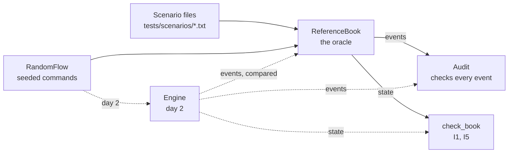

# Orderbook

A limit order book and matching engine in C++20: price-time priority, with limit, market, immediate-or-cancel
(IOC) and cancel orders, built to be checked against a written specification and then made fast without changing
a single event.

**Status: day 1 of 5.** The specification ([DESIGN.md](DESIGN.md)), the shared types and text format, the
reference model that implements the rules literally, the test kit around it (scenario files, a seeded random
command stream, invariant checks, a minimizer for failing runs, two fuzz targets), a command-line tool, the benchmark
harness, coverage, and CI on Linux and macOS. The fast engine is day 2's work; it will run against everything here.

## Why it is built this way

A matching engine is easy to get almost right. The hard part is knowing it is exactly right: that every trade went
to the best order by price and then arrival, at the right price, for the right quantity, with nothing lost. So day
1 builds the means of checking before the thing being checked:

1. **A specification** (DESIGN.md): validation and the order of its checks, the matching rules, what each command
   produces and in what order, and seven invariants.
2. **A reference model** (`ReferenceBook`) that is that specification as code, as directly as code allows: each side
   is a vector in arrival order, and the best order is found by scanning it. It is slow on purpose. It is the
   oracle the engine is compared with, event for event, on millions of random commands.
3. **Independent checks** of any book: `Audit` follows a run and checks every event against its own record of the
   orders, and `check_book` checks a book's state. They share none of the reference model's matching code, so they
   check the oracle too.
4. **Determinism** everywhere: the same commands give the same events on every platform, and the same seed gives
   the same random commands with libstdc++ and libc++, so a failure in CI can be replayed on this Mac.

## Architecture

Day 1's pieces, and where the engine goes:



The target system (day 4) puts the engine on its own thread between a TCP gateway and two lock-free rings; DESIGN.md
has that diagram and the plan for each day.

| Path | What it is |
|---|---|
| `include/orderbook/types.hpp` | `Price` (ticks), `Quantity` (lots), `OrderId` as distinct types; sides; order types; the validation bounds |
| `include/orderbook/command.hpp`, `event.hpp` | Commands (new order, cancel) and events (accepted, rejected, trade, cancelled) |
| `include/orderbook/text.hpp` | The one-line text form of each, and depth (`101x10 100x5`) |
| `include/orderbook/reference_book.hpp` | The reference model |
| `include/orderbook/scenario.hpp` | Scenario files: parse and run against any book |
| `include/orderbook/random_flow.hpp` | The seeded random command stream |
| `include/orderbook/check.hpp` | `check_book` and `Audit` |
| `include/orderbook/minimize.hpp` | Shrinks a failing command stream to the commands the failure needs |
| `tools/orderbook_cli.cpp` | The `orderbook` command-line tool |
| `tests/`, `bench/`, `fuzz/` | GoogleTest suite and scenario files; Google Benchmark suite; libFuzzer targets |
| `scripts/gcc_check.sh` | Compiles the project with Homebrew's GCC, to catch GCC-only warnings before CI does |

The `orderbook` library will hold the engine and has no dependencies; `orderbook_testkit` holds the reference model
and the checks, for tests, benchmarks and the tool.

## The rules in one example

Asks of 10 lots at 101 and 10 at 102; an IOC buy for 15 up to 102 takes order 1 at its price, 101, then 5 lots of
order 2 at 102. A market sell for 25 finds only order 4's 20 lots, and the rest is cancelled. Order 2 then has 5 lots
left to cancel; cancelling it again is rejected. This is the tool's real output:

```
$ printf 'new 1 sell limit 10 @ 101\nnew 2 sell limit 10 @ 102\nnew 3 buy ioc 15 @ 102\nnew 4 buy limit 20 @ 100\nnew 5 sell market 25\ncancel 2\ncancel 2\n' | build/dev/orderbook run
> new 1 sell limit 10 @ 101
accepted 1
> new 2 sell limit 10 @ 102
accepted 2
> new 3 buy ioc 15 @ 102
accepted 3
trade 3 1 10 @ 101
trade 3 2 5 @ 102
> new 4 buy limit 20 @ 100
accepted 4
> new 5 sell market 25
accepted 5
trade 5 4 20 @ 100
cancelled 5 5 unfilled
> cancel 2
cancelled 2 5 requested
> cancel 2
rejected 2 unknown-order
= bids
= asks
```

The full rules, including validation (ids must increase; quantities and prices are 1 to 10^9) and what a rejection
leaves unchanged (everything), are in DESIGN.md.

## Build, test, run

Needs CMake 3.25 or newer, Ninja, and a C++20 compiler; CI uses GCC 14 and Clang 18 on Ubuntu 24.04 and Apple
Clang on macOS 15, and this Mac has Apple Clang 21. GoogleTest 1.18.0 and Google Benchmark 1.9.5 are fetched at
configure time as release tarballs pinned by SHA-256.

```bash
make check
```

Configures the `dev` preset (Debug, warnings as errors) into `build/dev`, builds everything, and runs the 92 tests.
`make asan` runs them under AddressSanitizer and UndefinedBehaviorSanitizer; `make bench` builds the `release`
preset (-O3) and runs the benchmarks; `make coverage` reports the tests' line and branch coverage (Clang only);
`make gcc-check` compiles the project's files with GCC 15, Debug and Release, warnings as errors.

The command-line tool (`build/dev/orderbook`, using the reference model):

```bash
build/dev/orderbook check tests/scenarios/*.txt   # run scenario files; exit 1 on a mismatch
build/dev/orderbook gen 42 1000 | build/dev/orderbook run   # a random stream and what the book does with it
build/dev/orderbook audit 1 100000 --target 500   # a random run with every invariant check on
```

`run`'s transcript is itself a scenario file, so a failing random case can be saved, cut down by hand, and kept as a
test. The last command printed `commands 100000, accepted 57523, rejected 17942, trades 27686, cancelled 29213;
resting at the end 331, at most 344` in 0.89 s (Debug build, at `dc9ea98`); most of the rejections are cancels of
orders that had already filled.

## When a random run fails

`minimize` (`include/orderbook/minimize.hpp`, ddmin) shrinks a failing stream to commands that still fail, each of
which is needed. In `minimize_test.cpp` a deliberately broken book reports a tick too high for any trade with a maker
that has traded before; the Audit catches it in a 3,000-command random run, and 32 replays later this is what is left
(printed by a throwaway program with the test's broken book, at `dc9ea98`; the ids are the random stream's):

```
> new 1754 sell limit 76 @ 9943
accepted 1754
> new 1758 buy ioc 1 @ 9950
accepted 1758
trade 1758 1754 1 @ 9943
> new 1762 buy market 40
accepted 1762
trade 1762 1754 40 @ 9944
audit: command 3 'new 1762 buy market 40': 'trade 1762 1754 40 @ 9944': the maker's price is 9943
```

Day 2's differential tests will report a disagreement between the engine and the reference model the same way.

## Results (day 1)

The reference model's throughput, the baseline the engine has to beat, measured with `make bench` (Google Benchmark,
5 repetitions, medians) on an Apple M3, macOS 26.6.2, Apple Clang 21 at -O3, on battery with Low Power Mode off and
other apps open. Synthetic commands from `RandomFlow` (seed 42, the default mix); each run times 10,000 commands
against a book first filled to its size. Two runs: at `ec245ab` (11:40, battery 44%, load average 1.9), and at
`a900bb9` (12:16, battery 52%, load average 3.0), after the stream gained double spoils and resends, which is why
the books differ a little.

| Book held near | Resting at the start | Commands/s, `ec245ab` | Per command | Resting | Commands/s, `a900bb9` | Per command |
|---|---|---|---|---|---|---|
| 10 | 6 | 85.9 M | 11.6 ns | 6 | 85.5 M | 11.8 ns |
| 100 | 74 | 26.1 M | 38 ns | 70 | 23.0 M | 43 ns |
| 1,000 | 582 | 4.54 M | 220 ns | 567 | 4.36 M | 233 ns |
| 10,000 | 5,417 | 535 k | 1.87 µs | 5,540 | 502 k | 2.03 µs |

The second run was slower by up to 12% and noisier (coefficients of variation up to 8.5% in wall time, against 1.7%
at most in the first), on a busier machine. Either way, from about 570 to about 5,500 orders (9.3 to 9.8 times as
many) the cost per command grew 8.5 to 8.7 times: linear in the book's size, as a model that scans a side for every
fill and cancel should be. Generating a command costs 13.5 ns in the first run and 16.5 ns in the second
(`BM_RandomFlowNext`); benchmarks generate their commands before timing. macOS doesn't let Google Benchmark pin
its thread ("Failed to set thread affinity"), and the CPU frequency it prints (24 MHz) is the timer's, not the
core's.

## Tests

92 tests (`make check`), each a separate CTest test; CI runs them on four jobs and fuzzes on a fifth.

`make coverage` (Clang source-based coverage, at `a900bb9`): the GoogleTest suite runs 98.7% of the lines in `src/`
and `include/` (741 of 751), 97.3% of branches (469 of 482) and 97.8% of regions. The 10 lines it doesn't run are the
`"?"` fallbacks for enum values outside their names (four), `PrintTo` (called only when an assertion fails; three),
and three defaulted `==` operators the tests never call directly. (At `7e6a317`, before the review's fixes and the
minimizer: 687 of 697 lines, 426 of 442 branches.)

| File | What it checks |
|---|---|
| `types_test.cpp` | The strong types don't convert into each other; bounds are inclusive; the words round-trip |
| `text_test.cpp` | Each command and event's exact text; strict parsing (20 malformed lines, each with its reason); 20,000 random commands, edge values included, parse back to themselves |
| `reference_book_test.cpp` | The reference model's queries, the order of the validation checks, a rejection changing nothing, which orders can be cancelled |
| `scenario_test.cpp` + `scenarios/*.txt` | Fourteen hand-written scripts, one or more per rule; the parser's and runner's error reports, with line numbers |
| `random_flow_test.cpp` | Same seed same stream; a pinned hash of seed 1's first 100,000 commands, so Linux and macOS must agree; the documented mix on each side of the target; options it can't honour are refused; near either price bound every order sent valid is accepted; rejected orders resent under the same id are accepted, and some rejections break two rules |
| `check_test.cpp` | The reference model passes `Audit` and `check_book` over 160,000 random commands: four seeds of the default mix, and mixes with long queues at three prices (every check after every command), quantities up to 10^9 on a near-empty book, and 30% invalid orders; each check is shown to fail on events or a state that break its rule; a pinned hash of the reference model's events and book (I7) |
| `review/*.cpp` | The day-1 review's reproductions, kept as regression tests: 0-lot trades after a fill, and a stream starting near a price bound |
| `minimize_test.cpp` | The minimizer keeps exactly what a failure needs, in order, and is 1-minimal; random runs that catch two deliberately broken books shrink to 3 commands and to 1 |
| CLI tests (`tests/CMakeLists.txt`) | `check` passes the scenarios and reports a wrong one with its line; a 2,000-command transcript passes its own check |

## Review of day 1

One background agent reviewed the code at `ec245ab`, as a correctness review in its own worktree, in 19 minutes. It
saved each bug it reproduced as a failing test (now in `tests/review/`), and I reproduced each one here before fixing
it:

1. **The Audit accepted 0-lot trades after the taker was filled.** Once filled, each further trade expected a fill of
   `min(0, ...)`, so any number of `trade 3 2 0 @ 101` passed. Fixed in `7ddd342`.
2. **RandomFlow sent invalid orders as valid near a price bound.** It clamped the mid only once the mid first moved,
   so from start price 10 it sent `new 2 buy limit 51 @ -22` as valid. It also accepted options it couldn't honour,
   one of them undefined behaviour in `std::clamp`. Fixed in `a6d6edf`.
3. **GCC 15 reports a false null dereference** in `Price`'s defaulted comparison, in an optimised build; GCC 14 had
   reported one inside libstdc++ earlier the same day. `-Wnull-dereference` is now Clang-only (`2429960`), and
   `make gcc-check` compiles the project with Homebrew's GCC 15 before a push.

Of its 67 mutations, four changed nothing any test noticed: the Audit's limit check and its quantity-before-price
order, `check_book`'s best-price check, and RandomFlow's mid clamp. Each now has a test that fails without it
(`6b691c0`, `a6d6edf`), checked by mutating each again here. It also pointed out that random runs never tested the
order of the validation checks or I6, which they now do (`a3df324`), and that I7 had no test (`9427457`). Seven claims
in the docs said more than the code did, among them that every invariant check ran after every command; they are
corrected. It confirmed the reference model against DESIGN.md rule by rule (all 19 of its mutations were caught), and
all eleven scenario files of the time step by step, by hand.

## Design decisions

- **Integer ticks and lots, as distinct types.** Exact comparison and sums, and a quantity passed where a price
  belongs doesn't compile. The bounds (10^9 each) keep every sum the book can form inside an `int64`.
- **Order ids must increase.** The engine detects a duplicate with one comparison and no memory of past ids, and an
  id can never be reused, so a late cancel can't hit a newer order. The gateway (day 4) assigns them; clients keep
  their own.
- **A rejected command changes nothing**, not even the last accepted id, so a client can fix an order and resend it
  under the same id, and tests can compare the whole book before and after.
- **One `trade` event per fill**, at the maker's price, naming both orders; a limit order's rest is silent. Execution
  reports for each side are the gateway's job.
- **The order of the validation checks is part of the specification**, so two implementations agree on the reason
  for a rejection, not just on the rejection.
- **A deliberately naive reference model** as the oracle, instead of trusting the engine's own unit tests: the
  differential tests (day 2) compare every event, which no hand-written test can do at scale.
- **Its own random number generator.** `std::uniform_int_distribution` is implementation-defined, so the same seed
  gives different streams with libstdc++ and libc++; SplitMix64 with an unbiased bounded draw doesn't.
- **Dependencies pinned by hash and runners pinned by version** (`ubuntu-24.04`, `macos-15`), so the build can't
  change underneath a commit. GitHub moves `ubuntu-latest` to Ubuntu 26 from October 19.
- **Warnings as errors on three compilers.** On day 1 GCC caught four things Clang doesn't warn about: a shadowed
  parameter in a GoogleTest macro, an assertion under a bare `if`, a cast that is a no-op only on Linux (where
  `int64_t` is `long`), and a false "null dereference" inside libstdc++ at -O3. This Mac has no GCC, so CI is the
  only place they can show up; WALKTHROUGH.md has the details.

## Limitations

- One instrument per book; no order modification (cancel and re-enter), self-trade prevention, fill-or-kill, stop
  or iceberg orders, auctions, fees, persistence, or negative prices.
- The reference model is O(n) per fill and cancel by design; it is not the engine.
- The benchmark numbers above were measured on battery with other apps open; the engine's benchmarks (day 3) will
  be measured on power with nothing else running.

## License

MIT
