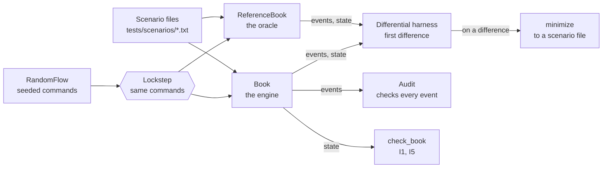

# Orderbook

A limit order book and matching engine in C++20: price-time priority, with limit, market, immediate-or-cancel
(IOC) and cancel orders, built to be checked against a written specification and then made fast without changing
a single event.

**Status: day 2 of 5.** Day 1 built the specification ([DESIGN.md](DESIGN.md)), the shared types and text format,
the reference model that implements the rules literally, and the test kit around it (scenario files, a seeded random
command stream, invariant checks, a minimizer for failing runs, two fuzz targets, a command-line tool, benchmarks,
coverage, CI on Linux and macOS). Day 2 adds the matching engine (`Book`: price levels in a map, a FIFO queue per
level, an id index for cancels) and a differential harness that runs it against the reference model, comparing every
event of 720,000 random commands in the tests (and as many as wanted from the CLI), and shrinks any disagreement to
a scenario file. Day 3 makes the engine fast.

## Why it is built this way

A matching engine is easy to get almost right. The hard part is knowing it is exactly right: that every trade went
to the best order by price and then arrival, at the right price, for the right quantity, with nothing lost. So day
1 builds the means of checking before the thing being checked:

1. **A specification** (DESIGN.md): validation and the order of its checks, the matching rules, what each command
   produces and in what order, and seven invariants.
2. **A reference model** (`ReferenceBook`) that is that specification as code, as directly as code allows: each side
   is a vector in arrival order, and the best order is found by scanning it. It is slow on purpose. It is the
   oracle the engine is compared with, event for event, on millions of random commands.
3. **Independent checks** of any book: `Audit` follows a run and checks every event against its own record of the
   orders, and `check_book` checks a book's state. They share none of the reference model's matching code, so they
   check the oracle too.
4. **Determinism** everywhere: the same commands give the same events on every platform, and the same seed gives
   the same random commands with libstdc++ and libc++, so a failure in CI can be replayed on this Mac.

## Architecture

How the engine is checked:



The target system (day 4) puts the engine on its own thread between a TCP gateway and two lock-free rings; DESIGN.md
has that diagram and the plan for each day.

| Path | What it is |
|---|---|
| `include/orderbook/types.hpp` | `Price` (ticks), `Quantity` (lots), `OrderId` as distinct types; sides; order types; the validation bounds |
| `include/orderbook/command.hpp`, `event.hpp` | Commands (new order, cancel) and events (accepted, rejected, trade, cancelled) |
| `include/orderbook/text.hpp` | The one-line text form of each, and depth (`101x10 100x5`) |
| `include/orderbook/book.hpp`, `src/book.cpp` | The engine (`Book`) |
| `include/orderbook/resting_order.hpp` | A resting order as both books report it |
| `include/orderbook/reference_book.hpp` | The reference model |
| `include/orderbook/scenario.hpp` | Scenario files: parse and run against any book |
| `include/orderbook/random_flow.hpp` | The seeded random command stream |
| `include/orderbook/check.hpp` | `check_book` and `Audit` |
| `include/orderbook/minimize.hpp` | Shrinks a failing command stream to the commands the failure needs |
| `include/orderbook/differential.hpp` | Two books in lockstep: the first difference, shrunk to a scenario file |
| `tools/orderbook_cli.cpp` | The `orderbook` command-line tool |
| `tests/`, `bench/`, `fuzz/` | GoogleTest suite and scenario files; Google Benchmark suite; libFuzzer targets |
| `scripts/gcc_check.sh` | Compiles the project with Homebrew's GCC, to catch GCC-only warnings before CI does |

The `orderbook` library holds the engine and has no dependencies; `orderbook_testkit` holds the reference model and
the checks, for tests, benchmarks and the tool.

### The engine

Each side is a `std::map` from price to that price's level, kept best first, so the best price is the map's first
entry. Each level is a `std::list` of its orders in arrival order, with its total quantity kept as orders fill and
cancel. An index (`std::unordered_map`) from order id to the order's place, an iterator to its level and one to its
list node, makes a cancel O(1) amortised: no search for the order, none for its level.

| Operation | Cost |
|---|---|
| New order that rests | O(log L) to find or make its level (L levels on its side), O(1) to queue it and index it |
| A taker's fills | O(1) per maker filled or reached; O(1) amortised to drop each level it empties |
| Cancel | O(1) amortised: the index finds the node, the list unlinks it, an emptied level is erased by iterator |
| Best price | O(1): the first entry of the side's map |
| Depth | O(L): one entry per level, from its kept total |

`Book` is move-only: its index holds iterators into its own containers, so a member-wise copy would leave the copy's
index pointing into the original (the copy constructor is deleted, and a test says so). Moving keeps them valid,
since node-based containers hand over their nodes.

## The rules in one example

Asks of 10 lots at 101 and 10 at 102; an IOC buy for 15 up to 102 takes order 1 at its price, 101, then 5 lots of
order 2 at 102. A market sell for 25 finds only order 4's 20 lots, and the rest is cancelled. Order 2 then has 5 lots
left to cancel; cancelling it again is rejected. This is the tool's real output, from the engine (the reference model
gives the same transcript, byte for byte):

```
$ printf 'new 1 sell limit 10 @ 101\nnew 2 sell limit 10 @ 102\nnew 3 buy ioc 15 @ 102\nnew 4 buy limit 20 @ 100\nnew 5 sell market 25\ncancel 2\ncancel 2\n' | build/dev/orderbook run
> new 1 sell limit 10 @ 101
accepted 1
> new 2 sell limit 10 @ 102
accepted 2
> new 3 buy ioc 15 @ 102
accepted 3
trade 3 1 10 @ 101
trade 3 2 5 @ 102
> new 4 buy limit 20 @ 100
accepted 4
> new 5 sell market 25
accepted 5
trade 5 4 20 @ 100
cancelled 5 5 unfilled
> cancel 2
cancelled 2 5 requested
> cancel 2
rejected 2 unknown-order
= bids
= asks
```

The full rules, including validation (ids must increase; quantities and prices are 1 to 10^9) and what a rejection
leaves unchanged (everything), are in DESIGN.md.

## Build, test, run

Needs CMake 3.25 or newer, Ninja, and a C++20 compiler; CI uses GCC 14 and Clang 18 on Ubuntu 24.04 and Apple
Clang on macOS 15, and this Mac has Apple Clang 21. GoogleTest 1.18.0 and Google Benchmark 1.9.5 are fetched at
configure time as release tarballs pinned by SHA-256.

```bash
make check
```

Configures the `dev` preset (Debug, warnings as errors) into `build/dev`, builds everything, and runs the 165 tests.
`make asan` runs them under AddressSanitizer and UndefinedBehaviorSanitizer; `make bench` builds the `release`
preset (-O3) and runs the benchmarks; `make soak` runs the engine against the reference model on 1.04 billion random
commands (below); `make coverage` reports the tests' line and branch coverage (Clang only);
`make gcc-check` compiles the project's files with GCC 15, Debug and Release, warnings as errors.

The command-line tool (`build/dev/orderbook`; `check`, `run` and `audit` use the engine unless given
`--book reference`):

```bash
build/dev/orderbook check tests/scenarios/*.txt   # run scenario files; exit 1 on a mismatch
build/dev/orderbook --book reference check tests/scenarios/*.txt   # the same on the reference model
build/dev/orderbook gen 42 1000 | build/dev/orderbook run   # a random stream and what the book does with it
build/dev/orderbook audit 1 100000 --target 500   # a random run with every invariant check on
build/dev/orderbook diff 1 1000000 --target 500   # the engine against the reference model, event for event
```

`run`'s transcript is itself a scenario file, so a failing random case can be saved, cut down by hand, and kept as a
test; each book passes the other's transcript of a random stream (two CLI tests). At `b0e54b2` (Debug build), the
`audit` line printed `commands 100000, accepted 57516, rejected 17972, trades 27713, cancelled 29176; resting at the
end 325, at most 342` in 0.60 s on the engine (0.87 s on the reference model at `cdaf411`); most of the rejections are
cancels of orders that had already filled. The `diff` line printed `commands 1000000: the same events from both books,
and the same state every 1000 commands and at the end` in 3.72 s. On a difference, `diff` reports it on stderr at
once, then prints the shrunk commands as a scenario file and exits 1.

`make soak` (`scripts/diff_soak.sh`) runs the release build's `diff` on six mixes, four seeds each, four runs at a
time: 50 million commands a run for the default mix, long queues at three prices, one-lot orders, quantities to 10^9 on
a nearly empty book, and 30% spoiled orders, and 10 million for a deep book (target 5,000 orders over 2,000 ticks). At
`5d65524` it printed `24 runs, 1040000000 commands, in 48 s`, every run `ok` (on power, 10:49). Run on a deliberately
broken engine (the time-priority mutation below), all 24 runs reported a difference. Three of them also crashed: the
broken engine's index held iterators to freed nodes. Two had already printed the difference (it is reported before
the shrinking, which replays the broken book many times); one crashed before its events differed, and the ASan build
(`build/asan/orderbook`, from `make asan`) reports that one as a heap-use-after-free in `Book::cancel`. A book with a
memory error can crash a differential run; the sanitizer build says where.

## When a random run fails

`minimize` (`include/orderbook/minimize.hpp`, ddmin) shrinks a failing stream to commands that still fail, each of
which is needed. In `minimize_test.cpp` a deliberately broken book reports a tick too high for any trade with a maker
that has traded before; the Audit catches it in a 3,000-command random run, and 32 replays later this is what is left
(printed by a throwaway program with the test's broken book, at `dc9ea98` and again, the same, at `cdaf411`; the ids
are the random stream's):

```
> new 1754 sell limit 76 @ 9943
accepted 1754
> new 1758 buy ioc 1 @ 9950
accepted 1758
trade 1758 1754 1 @ 9943
> new 1762 buy market 40
accepted 1762
trade 1762 1754 40 @ 9944
audit: command 3 'new 1762 buy market 40': 'trade 1762 1754 40 @ 9944': the maker's price is 9943
```

The differential harness reports a disagreement between two books the same way, as a scenario file of the expected
book's events. To show what one looks like, the engine was broken on purpose: a resting order went to the front of
its level instead of the back (`push_front` for `push_back`, which also left the index pointing at the wrong node).
The default-mix test failed on all four seeds; seed 1's report, as the test printed it (code of `aebdffb`):

```
seed 1, command 7: events: expected 'cancelled 4 77 requested', actual 'cancelled 4 56 requested'
# The books disagree on these 3 commands, shrunk from 7.
# Each command's events are the expected book's.
> new 3 sell limit 56 @ 10011
accepted 3
> new 4 sell limit 77 @ 10011
accepted 4
# the events agree, but then asks: expected '3:10011x56 4:10011x77', actual '4:10011x77 3:10011x56'
> cancel 4
cancelled 4 77 requested
# but the book under test gave: cancelled 4 56 requested
= bids
= asks 10011x56
```

The broken engine fails that file and the reference model passes it, so saved under `tests/scenarios/` it would be a
regression test. Before `cabaf95` the same failure shrank to the first two commands, whose events agree: the shrinking
accepted any difference, and the queue's wrong order shows in the state one command before it shows in an event. Now a
difference first seen in the events is shrunk to one that still shows in the events. A difference seen only in the
state, as in the three mixes that compare states after every command, still shrinks by the state; if it is in the
order of a queue, which depth lines don't show, the file's comment names it but the file passes.

## Results (day 2)

Both books on the same work, measured with `make bench` at `b0e54b2` (Google Benchmark, 5 repetitions, medians) on an
Apple M3, macOS 26.6.2, Apple Clang 21 at -O3, at 10:34 on battery (21% to 20%, Low Power Mode off) during a video call,
load average 8.9 to 15.7 (the rows marked * are from a second run). Synthetic commands from `RandomFlow` (seed 42, the
default mix): a warm-up fills a book to its size, then the same 10,000 commands are timed against it, for each book; the
`resting` counters (7, 70, 583, 5,410) show both started from the same book. Coefficients of variation were 4.1% at
most.

| Book held near | Resting at the start | Reference model | Per command | Engine | Per command | Engine ÷ reference |
|---|---|---|---|---|---|---|
| 10 | 7 | 86.0 M/s | 11.6 ns | 20.4 M/s | 49 ns | 0.24 |
| 100 | 70 | 25.3 M/s | 40 ns | 20.9 M/s | 48 ns | 0.83 |
| 200 * | 108 | 15.8 M/s | 63 ns | 22.7 M/s | 44 ns | 1.44 |
| 400 * | 240 | 8.98 M/s | 111 ns | 23.1 M/s | 43 ns | 2.6 |
| 1,000 | 583 | 4.40 M/s | 227 ns | 23.0 M/s | 43 ns | 5.2 |
| 10,000 | 5,410 | 516 k/s | 1.94 µs | 18.9 M/s | 53 ns | 37 |

\* The rows for 200 and 400 are a second run, of those sizes alone, at 10:41 (battery 17%, load average 4.7 to 6.1;
the same code, with the two sizes added to the benchmark in `bench/book_bench.cpp`); the reference model's 200 row
had a coefficient of variation of 10.8% in wall time.

The engine's cost per command stays between 43 and 53 ns from 7 orders to 5,410, where the reference model's grows
with the book (it scans a side for every fill and cancel). But on small books the engine is slower: 4 times slower at
7 orders, and still slower at 70; it is ahead from 108 orders on, so the crossover is between 70 and 108. On a small
book the reference model's whole side is a few cache lines of a vector it scans without allocating, while the engine
allocates a list node, a hash node and sometimes a map node for each order that rests, frees them as it fills and
cancels, and follows pointers through all three. Taking that allocation and pointer-chasing off the hot path is day
3's work (intrusive lists, a pool, an open-addressing index), measured against these numbers on power.

## Results (day 1)

The reference model's throughput, the baseline the engine has to beat, measured with `make bench` (Google Benchmark,
5 repetitions, medians) on an Apple M3, macOS 26.6.2, Apple Clang 21 at -O3, on battery with Low Power Mode off and
other apps open. Synthetic commands from `RandomFlow` (seed 42, the default mix); each run times 10,000 commands
against a book first filled to its size. Two runs: at `ec245ab` (11:40, battery 44%, load average 1.9), and at
`a900bb9` (12:16, battery 52%, load average 3.0), after the stream gained double spoils and resends, which is why
the books differ a little.

| Book held near | Resting at the start | Commands/s, `ec245ab` | Per command | Resting | Commands/s, `a900bb9` | Per command |
|---|---|---|---|---|---|---|
| 10 | 6 | 85.9 M | 11.6 ns | 6 | 85.5 M | 11.8 ns |
| 100 | 74 | 26.1 M | 38 ns | 70 | 23.0 M | 43 ns |
| 1,000 | 582 | 4.54 M | 220 ns | 567 | 4.36 M | 233 ns |
| 10,000 | 5,417 | 535 k | 1.87 µs | 5,540 | 502 k | 2.03 µs |

The second run was slower by up to 12% and noisier (coefficients of variation up to 8.5% in wall time, against 1.7%
at most in the first), on a busier machine. Either way, from about 570 to about 5,500 orders (9.3 to 9.8 times as
many) the cost per command grew 8.5 to 8.7 times: linear in the book's size, as a model that scans a side for every
fill and cancel should be. Generating a command costs 13.5 ns in the first run and 16.5 ns in the second
(`BM_RandomFlowNext`); benchmarks generate their commands before timing. macOS doesn't let Google Benchmark pin
its thread ("Failed to set thread affinity"), and the CPU frequency it prints (24 MHz) is the timer's, not the
core's.

## Tests

165 tests (`make check`), each a separate CTest test; CI runs them on four jobs and fuzzes on a fifth.

`make coverage` (Clang source-based coverage of `src/` and `include/` by everything CTest runs: the GoogleTest suite,
and the CLI tests and fuzz runs, whose profiles are merged in), at `cdaf411`: 98.7% of lines (746 of 756), 97.3% of
branches (475 of 488), 97.8% of regions. The 10 lines nothing runs are the `"?"` fallbacks for enum values outside
their names (four), `PrintTo` (called only when an assertion fails; three), and three defaulted `==` operators the
tests never call directly. (At `7e6a317`, before the reviews and the minimizer: 687 of 697 lines, 426 of 442
branches. At `a900bb9`, 741 of 751 and 469 of 482; the second review found that one of those branches,
`scenario.cpp:53`'s, is reached only by a fuzz run.)

| File | What it checks |
|---|---|
| `types_test.cpp` | The strong types don't convert into each other; bounds are inclusive; the words round-trip |
| `text_test.cpp` | Each command and event's exact text; strict parsing (20 malformed lines, each with its reason); 20,000 random commands, edge values included, parse back to themselves |
| `books_test.cpp` | Both books (a typed suite): their queries, the order of the validation checks, a rejection changing nothing, which orders can be cancelled, a sweep through levels |
| `book_test.cpp` | The engine's structure: levels that empty leave the book, a level's total, cancels from the front, middle and back of a queue, a partly filled maker keeps its place, a sweep through 1,000 levels, a moved book's index (under ASan too), and that `Book` can't be copied |
| `scenario_test.cpp` + `scenarios/*.txt` | Fourteen hand-written scripts, one or more per rule, on both books; the parser's and runner's error reports, with line numbers |
| `differential_test.cpp` | The engine against the reference model, every event of 720,000 random commands in seven mixes (the default, long queues at three prices, one-lot orders, quantities to 10^9 on a nearly empty book, 30% spoiled orders, a deep book of 900+ levels a side, prices at both bounds), states compared at checkpoints (after every command in three mixes); the engine's events under the Audit and its state under `check_book` too |
| `differential_harness_test.cpp` | The harness itself, with deliberately broken books (`broken_books.hpp`): two reference models never differ; the first differing command is named; a state-only bug is found at a checkpoint; price, depth and time-priority bugs shrink to 3 commands each, in files the broken book fails; the streaming `diff` stops where `first_difference` does |
| `random_flow_test.cpp` | Same seed same stream; a pinned hash of seed 1's first 100,000 commands, so Linux and macOS must agree; the documented mix on each side of the target; options it can't honour are refused; near either price bound every order sent valid is accepted; rejected orders resent under the same id are accepted, and some rejections break two rules; in a fully spoiled stream only resends are accepted, about half come back, and resent limit orders can be cancelled |
| `check_test.cpp` | The reference model passes `Audit` and `check_book` over 160,000 random commands: four seeds of the default mix, and mixes with long queues at three prices (every check after every command), quantities up to 10^9 on a near-empty book, and 30% invalid orders; each check is shown to fail on events or a state that break its rule; a pinned hash of the reference model's events and book (I7) |
| `review/*.cpp`, `review2/` | The two day-1 reviews' reproductions, kept as regression tests: 0-lot trades after a fill; a stream starting near a price bound; double spoils that broke one rule; an empty transcript `check` rejected |
| `minimize_test.cpp` | The minimizer keeps exactly what a failure needs, in order, and is 1-minimal; 1,000 commands shrink in under 100 replays (56); random runs that catch two deliberately broken books shrink to 3 commands and to 1 |
| CLI tests (`tests/CMakeLists.txt`) | `check` passes the scenarios on both books and reports a wrong one with its line and the actual events; a 2,000-command transcript passes its own check, and so does an empty one; each book passes the other's transcript of 5,000 commands; `audit` passes 20,000 commands on each book; `diff` agrees on 100,000; options out of range and bad arguments are reported; each exit code exactly (0, 1, 2) |
| Fuzz targets (`fuzz/`, in CTest) | Both on 2,000 seeded random inputs each; the text target on the scenario files whole and on each of their 405 lines, so its round-trip checks run. The book target runs both books in lockstep, comparing events and states after every command, with the Audit and `check_book` on the engine. CI's libFuzzer job runs each for 60 s instead: at `a900bb9` (the reference model alone), 1,351,472 text inputs and 232,863 book inputs, no findings |

## Review of day 1

One background agent reviewed the code at `ec245ab`, as a correctness review in its own worktree, in 19 minutes. It
saved each bug it reproduced as a failing test (now in `tests/review/`), and I reproduced each one here before fixing
it:

1. **The Audit accepted 0-lot trades after the taker was filled.** Once filled, each further trade expected a fill of
   `min(0, ...)`, so any number of `trade 3 2 0 @ 101` passed. Fixed in `7ddd342`.
2. **RandomFlow sent invalid orders as valid near a price bound.** It clamped the mid only once the mid first moved,
   so from start price 10 it sent `new 2 buy limit 51 @ -22` as valid. It also accepted options it couldn't honour,
   one of them undefined behaviour in `std::clamp`. Fixed in `a6d6edf`.
3. **GCC 15 reports a false null dereference** in `Price`'s defaulted comparison, in an optimised build; GCC 14 had
   reported one inside libstdc++ earlier the same day. `-Wnull-dereference` is now Clang-only (`2429960`), and
   `make gcc-check` compiles the project with Homebrew's GCC 15 before a push.

Of its 67 mutations, four changed nothing any test noticed: the Audit's limit check and its quantity-before-price
order, `check_book`'s best-price check, and RandomFlow's mid clamp. Each now has a test that fails without it
(`6b691c0`, `a6d6edf`), checked by mutating each again here. It also pointed out that random runs never tested the
order of the validation checks or I6, which they now do (`a3df324`), and that I7 had no test (`9427457`). Seven claims
in the docs said more than the code did, among them that every invariant check ran after every command; they are
corrected. It confirmed the reference model against DESIGN.md rule by rule (all 19 of its mutations were caught), and
all eleven scenario files of the time step by step, by hand.

A second agent then reviewed what the first hadn't seen (the CLI, the minimizer, the fuzz targets, the GCC script,
RandomFlow's double spoils and resends) at `aa0599b`, in 13 minutes, and found two more bugs, both reproduced here and
fixed: one double spoil in four didn't break two rules but overwrote the same field (18.2% of spoiled orders broke two
rules, not 25%; `d843fcf`), and `run` with no commands printed depth lines that `check` rejects (`cd389bd`). It also
found that the CLI tests' message matching made CTest ignore exit codes (now tested exactly, `1c3149e`), that the
text fuzzer's round-trip checks were never reached in CTest (`c00291c`), that `audit` ignored problems found mid-run
(`cd389bd`), that several generator mutants were caught only by the pinned hashes (now by properties, `2c2baee`), and
that nothing bounded the minimizer's replays (`cdaf411`); its docs corrections are in.

## Design decisions

- **Integer ticks and lots, as distinct types.** Exact comparison and sums, and a quantity passed where a price
  belongs doesn't compile. The bounds (10^9 each) keep every sum the book can form inside an `int64`.
- **Order ids must increase.** The engine detects a duplicate with one comparison and no memory of past ids, and an
  id can never be reused, so a late cancel can't hit a newer order. The gateway (day 4) assigns them; clients keep
  their own.
- **A rejected command changes nothing**, not even the last accepted id, so a client can fix an order and resend it
  under the same id, and tests can compare the whole book before and after.
- **One `trade` event per fill**, at the maker's price, naming both orders; a limit order's rest is silent. Execution
  reports for each side are the gateway's job.
- **The order of the validation checks is part of the specification**, so two implementations agree on the reason
  for a rejection, not just on the rejection.
- **A deliberately naive reference model** as the oracle, instead of trusting the engine's own unit tests: the
  differential tests compare every event, which no hand-written test can do at scale. The engine shares none of its
  code, not even validation, so a mistake copied into both can't hide.
- **The conventional engine first.** Day 2's engine uses standard containers (a map of levels, a list per level, a
  hash index), so its correctness is settled by the differential tests before day 3 changes its data structures for
  speed, and every day-3 change is checked against the same tests.
- **One comparator type for both sides** (`BetterPrice{side}`: higher first for bids, lower for asks). Bids and asks
  are then the same map type, so the index holds one kind of iterator for either side and the matching code isn't a
  template; the price of that is a branch on the side in each comparison.
- **The index holds iterators, so `Book` is move-only.** A cancel never searches. A copy would need the index rebuilt
  for the copy's own nodes; nothing needs a copy (the benchmark rebuilds its book from the warm-up instead).
- **A difference is reported as a scenario file**, shrunk by ddmin, so a failure on a random stream of a million
  commands becomes a few lines a person can read, run with `orderbook check`, and keep as a test.
- **Its own random number generator.** `std::uniform_int_distribution` is implementation-defined, so the same seed
  gives different streams with libstdc++ and libc++; SplitMix64 with an unbiased bounded draw doesn't.
- **Dependencies pinned by hash and runners pinned by version** (`ubuntu-24.04`, `macos-15`), so the build can't
  change underneath a commit. GitHub moves `ubuntu-latest` to Ubuntu 26 from October 19.
- **Warnings as errors on three compilers.** On day 1 GCC caught four things Clang doesn't warn about: a shadowed
  parameter in a GoogleTest macro, an assertion under a bare `if`, a cast that is a no-op only on Linux (where
  `int64_t` is `long`), and a false "null dereference" inside libstdc++ at -O3. CI's GCC 14 job is the only place
  the tests run under GCC; `make gcc-check` now compiles the project with Homebrew's GCC 15 here before a push
  (GoogleTest doesn't build with it against the macOS SDK, so it compiles but runs nothing). WALKTHROUGH.md has the
  details.

## Limitations

- One instrument per book; no order modification (cancel and re-enter), self-trade prevention, fill-or-kill, stop
  or iceberg orders, auctions, fees, persistence, or negative prices.
- The reference model is O(n) per fill and cancel by design; it is not the engine.
- Day 2's engine allocates on the hot path (a list node and a hash node for each order that rests, a map node for each
  new level) and is slower than the reference model on books of fewer than about a hundred orders; day 3 removes the
  allocation.
- Scenario files check events and depth, not the order of a queue, so a difference only in a queue's order shrinks to
  a file that names it in a comment but passes; the differential tests themselves still fail on it.
- The benchmark numbers above were measured on battery with other apps open (day 2's during a video call); day 3's
  are to be measured on power with nothing else running.

## License

MIT
