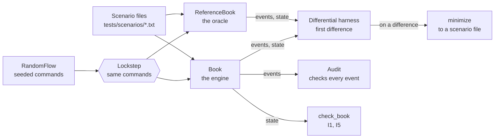
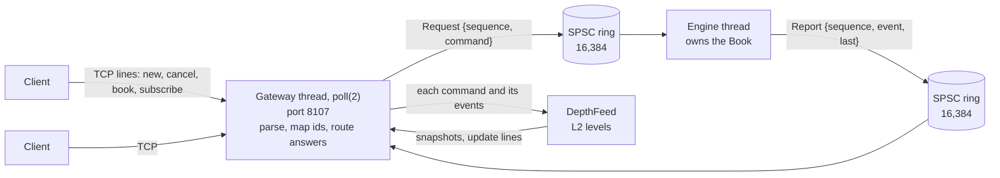

# Orderbook

A limit order book and matching engine in C++20: price-time priority, with limit, market, immediate-or-cancel
(IOC) and cancel orders, built to be checked against a written specification and then made fast without changing
a single event.

**Status: day 4 of 5.** Day 1 built the specification ([DESIGN.md](DESIGN.md)), the shared types and text format,
the reference model that implements the rules literally, and the test kit around it (scenario files, a seeded random
command stream, invariant checks, a minimizer for failing runs, two fuzz targets, a command-line tool, benchmarks,
coverage, CI on Linux and macOS). Day 2 added the matching engine (price levels in a map, a FIFO queue per level, an
id index for cancels) and a differential harness that runs it against the reference model, comparing every event of
720,000 random commands in the tests (and as many as wanted from the CLI), and shrinks any disagreement to a scenario
file. Day 3 rebuilt the engine for speed without changing an event (`Book`: order nodes in a pool linked by index,
intrusive FIFO levels, sorted level vectors, an open-addressing id table; nothing allocated once the book has room),
kept day 2's as `MapBook`, the baseline, and put the engine on its own thread between two lock-free single-producer
single-consumer rings, with latency percentiles measured from the sender's side. Day 4 put a TCP order gateway in
front of it (port 8107: clients' own ids mapped to the engine's, fills to each side, answers in line order, cancel on
disconnect, back-pressure) and an L2 market-data feed behind it, built from the engine's events (snapshots, an update
line per command for subscribers, gap detection), with `orderbook replay` for synthetic streams and a load generator
that times each command from when it was due.

## Why it is built this way

A matching engine is easy to get almost right. The hard part is knowing it is exactly right: that every trade went
to the best order by price and then arrival, at the right price, for the right quantity, with nothing lost. So day
1 builds the means of checking before the thing being checked:

1. **A specification** (DESIGN.md): validation and the order of its checks, the matching rules, what each command
   produces and in what order, and seven invariants.
2. **A reference model** (`ReferenceBook`) that is that specification as code, as directly as code allows: each side
   is a vector in arrival order, and the best order is found by scanning it. It is slow on purpose. It is the
   oracle the engine is compared with, event for event, on millions of random commands.
3. **Independent checks** of any book: `Audit` follows a run and checks every event against its own record of the
   orders, and `check_book` checks a book's state. They share none of the reference model's matching code, so they
   check the oracle too.
4. **Determinism** everywhere: the same commands give the same events on every platform, and the same seed gives
   the same random commands with libstdc++ and libc++, so a failure in CI can be replayed on this Mac.

## Architecture

How the engine is checked:



The system (day 4): the gateway's thread is the engine thread's one sender, and the depth feed follows the events:



DESIGN.md has the full target system and the plan for each day.

| Path | What it is |
|---|---|
| `include/orderbook/types.hpp` | `Price` (ticks), `Quantity` (lots), `OrderId` as distinct types; sides; order types; the validation bounds |
| `include/orderbook/command.hpp`, `event.hpp` | Commands (new order, cancel) and events (accepted, rejected, trade, cancelled) |
| `include/orderbook/text.hpp` | The one-line text form of each, and depth (`101x10 100x5`) |
| `include/orderbook/book.hpp`, `src/book.cpp` | The engine (`Book`, day 3) |
| `include/orderbook/id_table.hpp` | The engine's open-addressing index from order id to node |
| `include/orderbook/spsc_ring.hpp` | The lock-free single-producer single-consumer ring |
| `include/orderbook/engine_thread.hpp`, `src/engine_thread.cpp` | The engine on its own thread, between two rings |
| `include/orderbook/market_data.hpp`, `src/market_data.cpp` | The depth feed built from events, L2 snapshots, the subscriber (`L2Book`) |
| `include/orderbook/gateway.hpp`, `src/gateway.cpp` | The TCP order gateway (its own library, `orderbook_gateway`) |
| `tools/gateway_main.cpp` | The `orderbook_gateway` executable |
| `include/orderbook/map_book.hpp`, `src/map_book.cpp` | Day 2's engine (`MapBook`), kept as the baseline (test kit) |
| `include/orderbook/resting_order.hpp` | A resting order as both books report it |
| `include/orderbook/reference_book.hpp` | The reference model |
| `include/orderbook/scenario.hpp` | Scenario files: parse and run against any book |
| `include/orderbook/random_flow.hpp` | The seeded random command stream |
| `include/orderbook/check.hpp` | `check_book` and `Audit` |
| `include/orderbook/minimize.hpp` | Shrinks a failing command stream to the commands the failure needs |
| `include/orderbook/differential.hpp` | Two books in lockstep: the first difference, shrunk to a scenario file |
| `tools/orderbook_cli.cpp` | The `orderbook` command-line tool |
| `tests/`, `bench/`, `fuzz/` | GoogleTest suite and scenario files; Google Benchmark suite, `bench/latency.cpp` (latency percentiles) and `bench/loadgen.cpp` (the gateway's load generator); libFuzzer targets |
| `scripts/gcc_check.sh` | Compiles the project with Homebrew's GCC, to catch GCC-only warnings before CI does |
| `scripts/gateway_smoke.sh` | The gateway's executable end to end under the load generator, stopped with SIGINT (a CTest test) |

The `orderbook` library holds the engine, its thread and rings, and the depth feed, and needs only the standard
library and threads; `orderbook_gateway` adds the TCP gateway (POSIX sockets); `orderbook_testkit` holds the reference model, day 2's engine and the checks, for tests, benchmarks and the tool.

### The engine

Day 3's engine (`Book`; DESIGN.md "The engine" has the details and the alternatives):

- **A pool of order nodes.** Every resting order is a 40-byte node in one vector; nodes an order leaves go on a free
  list and are reused, so once the book has been as big as it gets, nothing is allocated. Nodes are linked by 32-bit
  indices, not pointers, so the pool can grow, and the book can be moved or copied, without breaking a link.
- **Levels are intrusive FIFOs** of those nodes (the level holds its oldest and newest, each node its neighbours), with
  the level's total kept as orders fill and cancel.
- **Each side is a vector of levels sorted worst first**, so the best level is the back: takers fill from the back and
  pop levels they empty; a level is found by binary search on price.
- **An open-addressing id table** (`IdTable`: linear probing, at most half full, Fibonacci hashing, deletion by
  backward shift, so no tombstones) finds the order a cancel names.
- **Room made up front** (`BookCapacity`, 4,096 orders and 1,024 levels a side by default): within it, matching never
  allocates (a test counts calls to `operator new`); past it, the book grows at each new high-water mark.

| Operation | Cost |
|---|---|
| New order that rests | O(log L) binary search for its level (L levels on its side), O(1) to append and index it; a new level is a vector insert that moves the levels better than it |
| A taker's fills | O(1) per maker filled or reached; O(1) to pop each level it empties (the back) |
| Cancel | One index probe on average, O(log L) to find its level, O(1) to unlink; an emptied level is erased, moving the levels above it |
| Best price | O(1): the back of the side's vector |
| Depth | O(L): one entry per level, from its kept total |

`Book` is copyable and movable member by member (links are indices into its own pool), and a copy keeps its original's
room; a moved-from book is empty and usable. If an allocation fails past the room, `apply` throws with the book
well-formed and the events so far saying exactly what the command did. Day 2's engine (`std::map` of `std::list` levels,
an `std::unordered_map` index) is `MapBook` in the test kit: the baseline in every benchmark, and a third book every
rule test and scenario file runs on.

### The engine's thread

`EngineThread` owns a `Book` on a thread of its own. A sender pushes `Request{sequence, command}` into one SPSC ring
and pops `Report{sequence, event, last}` from another; every command has at least one event, and its last is
flagged. The ring (`SpscRing`) is lock-free: one release store publishes a slot and one acquire load sees it, each
side caches the other's index, and the two indices live on separate 128-byte lines. The engine spins on an empty ring
(with the core's pause hint); the sender must keep receiving while it waits to send (back-pressure both ways);
`stop()` lets the engine apply everything already sent.

### The gateway

`Gateway` (DESIGN.md, "The gateway (day 4)") runs every TCP connection on one thread with `poll(2)`, and is the
engine thread's single sender. Clients send lines in the scenario files' command format and get lines back:

```
$ nc 127.0.0.1 8107                    (after: build/release/orderbook_gateway)
new 1 sell limit 10 @ 101
accepted 1
new 2 buy ioc 4 @ 101
accepted 2
fill 2 4 @ 101
fill 1 4 @ 101
book
snapshot 2 bids - asks 101x6
```

(That transcript is one client trading with itself, so it gets both fills; two clients would each get their own.)

- **Ids**: each client names its orders with its own ids, which must increase within its session; the gateway gives
  each order the engine's next id, keeps a route back, and forgets it once the order is done. A trade is a `fill` to
  each side under that side's own id, so no client learns another's.
- **Order of answers**: a session's answers come in the order of its lines. The engine's answers already do; the
  gateway's own (a rejection it makes, a snapshot, an `error`) wait behind the session's commands still in the engine.
- **Sessions** end when the client closes its side and everything is answered and written, after a line over 256
  bytes (once the answers before it and its `error` are written), or at once on a socket error or 4 MiB of answers
  the client doesn't read. Its live orders are then cancelled.
- **Back-pressure**: a full ring stops the handling of lines; a client with 1 MiB of unhandled input isn't read.

### Market data

`DepthFeed` (DESIGN.md, "Market data (day 4)") follows each command and its events on the gateway's thread and keeps
the book by price level, never reading the engine. It numbers the commands; for each it gives the levels changed,
each once, with the new total. `book [K]` answers with an L2 snapshot (`snapshot 7 bids 101x10 100x5 asks 102x7`);
`subscribe` answers with a full snapshot at sequence N and then sends an `update` line for every command after N
(`update 8 sell 101x0 buy 101x3`, or `update 9` for a command that changed no level). `L2Book` is a subscriber: it
applies updates in sequence and refuses a gap. `orderbook replay` runs a synthetic stream through a book and the
feed, printing snapshots (each checked against the book's own depth) and, with `--updates`, the update lines.

## The rules in one example

Asks of 10 lots at 101 and 10 at 102; an IOC buy for 15 up to 102 takes order 1 at its price, 101, then 5 lots of
order 2 at 102. A market sell for 25 finds only order 4's 20 lots, and the rest is cancelled. Order 2 then has 5 lots
left to cancel; cancelling it again is rejected. This is the tool's real output, from the engine (the reference model
gives the same transcript, byte for byte):

```
$ printf 'new 1 sell limit 10 @ 101\nnew 2 sell limit 10 @ 102\nnew 3 buy ioc 15 @ 102\nnew 4 buy limit 20 @ 100\nnew 5 sell market 25\ncancel 2\ncancel 2\n' | build/dev/orderbook run
> new 1 sell limit 10 @ 101
accepted 1
> new 2 sell limit 10 @ 102
accepted 2
> new 3 buy ioc 15 @ 102
accepted 3
trade 3 1 10 @ 101
trade 3 2 5 @ 102
> new 4 buy limit 20 @ 100
accepted 4
> new 5 sell market 25
accepted 5
trade 5 4 20 @ 100
cancelled 5 5 unfilled
> cancel 2
cancelled 2 5 requested
> cancel 2
rejected 2 unknown-order
= bids
= asks
= orders bids
= orders asks
= best bids none
= best asks none
= resting 0
= last-accepted 5
```

The last eight lines are the book's state at the end: both sides' depth, then each side's orders, its best price, the
number resting and the last accepted id, which `orderbook check` checks too. The full rules, including validation (ids
must increase; quantities and prices are 1 to 10^9) and what a rejection leaves unchanged (everything), are in
DESIGN.md.

## Build, test, run

Needs CMake 3.25 or newer, Ninja, and a C++20 compiler; CI uses GCC 14 and Clang 18 on Ubuntu 24.04 and Apple
Clang on macOS 15, and this Mac has Apple Clang 21. GoogleTest 1.18.0 and Google Benchmark 1.9.5 are fetched at
configure time as release tarballs pinned by SHA-256.

```bash
make check
```

Configures the `dev` preset (Debug, warnings as errors) into `build/dev`, builds everything, and runs the 296 tests.
`make asan` runs them under AddressSanitizer and UndefinedBehaviorSanitizer; `make tsan` runs the threaded ones (the
ring's, the engine thread's and the gateway's) under ThreadSanitizer; `make bench` builds the `release` preset (-O3)
and runs the benchmarks; `make latency` runs the latency percentiles (below); `make loadgen` runs the gateway's load
generator against a gateway in its own process (`LOADGEN_ARGS="--port 8107"` for one started separately); `make soak` runs the engine against the reference
model on 1.04 billion random commands (below); `make coverage` reports the tests' line and branch coverage (Clang
only); `make gcc-check` compiles the project's files with GCC 15, Debug and Release, warnings as errors.

The command-line tool (`build/dev/orderbook`; `check`, `run` and `audit` use the engine unless given
`--book reference`):

```bash
build/dev/orderbook check tests/scenarios/*.txt   # run scenario files; exit 1 on a mismatch
build/dev/orderbook --book reference check tests/scenarios/*.txt   # the same on the reference model
build/dev/orderbook gen 42 1000 | build/dev/orderbook run   # a random stream and what the book does with it
build/dev/orderbook audit 1 100000 --target 500   # a random run with every invariant check on
build/dev/orderbook diff 1 1000000 --target 500   # the engine against the reference model, event for event
build/dev/orderbook gen 1 1000000 | build/dev/orderbook replay --every 100000   # L2 snapshots of a synthetic stream
build/release/orderbook_gateway   # the TCP gateway on 127.0.0.1:8107, until Ctrl-C
```

`run`'s transcript is itself a scenario file, ending with the book's whole state, so a failing random case can be
saved, cut down by hand, and kept as a test; each book passes the other's transcript of a random stream, final queues
and all (two CLI tests). At `b0e54b2` (Debug build), the
`audit` line printed `commands 100000, accepted 57516, rejected 17972, trades 27713, cancelled 29176; resting at the
end 325, at most 342` in 0.60 s on the engine (0.87 s on the reference model at `cdaf411`); most of the rejections are
cancels of orders that had already filled. The `diff` line printed `commands 1000000: the same events from both books,
and the same state every 1000 commands and at the end` in 3.72 s. On a difference, `diff` reports it on stderr at
once, then prints the shrunk commands as a scenario file and exits 1.

`make soak` (`scripts/diff_soak.sh`) runs the release build's `diff` on six mixes, four seeds each, four runs at a time:
50 million commands a run for the default mix, long queues at three prices, one-lot orders, quantities to 10^9 on a
nearly empty book, and 30% spoiled orders, and 10 million for a deep book (a target of 5,000 orders within 2,000 ticks
either side of a moving mid). At `5d65524` it printed `24 runs, 1040000000 commands, in 48 s`, every run `ok` (on power,
10:49). Run on a deliberately broken engine (the time-priority mutation below), all 24 runs reported a difference. Three
of them also crashed: the broken engine's index held iterators to freed nodes. Two had already printed the difference
(it is reported before the shrinking, which replays the broken book many times); one crashed before its events differed,
and the ASan build (`build/asan/orderbook`, from `make asan`) reports that one as a heap-use-after-free in
`Book::cancel`. A book with a memory error can crash a differential run; the sanitizer build says where. (The script now
reports a run that crashed as `FAILED (exit 139)` rather than as a difference: on the same mutant at `820061f`, 22 runs
DIFFERENT and 2 FAILED.)

## When a random run fails

`minimize` (`include/orderbook/minimize.hpp`, ddmin) shrinks a failing stream to commands that still fail, each of
which is needed. In `minimize_test.cpp` a deliberately broken book reports a tick too high for any trade with a maker
that has traded before; the Audit catches it in a 3,000-command random run, and 32 replays later this is what is left
(printed by a throwaway program with the test's broken book, at `dc9ea98` and again, the same, at `cdaf411`; the ids
are the random stream's):

```
> new 1754 sell limit 76 @ 9943
accepted 1754
> new 1758 buy ioc 1 @ 9950
accepted 1758
trade 1758 1754 1 @ 9943
> new 1762 buy market 40
accepted 1762
trade 1762 1754 40 @ 9944
audit: command 3 'new 1762 buy market 40': 'trade 1762 1754 40 @ 9944': the maker's price is 9943
```

The differential harness reports a disagreement between two books the same way, as a scenario file of the expected
book's events. To show what one looks like, the engine was broken on purpose: a resting order went to the front of
its level instead of the back (`push_front` for `push_back`, which also left the index pointing at the wrong node).
The default-mix test failed on all four seeds; seed 1's report, as the test printed it (code of `aebdffb`):

```
seed 1, command 7: events: expected 'cancelled 4 77 requested', actual 'cancelled 4 56 requested'
# The books disagree on these 3 commands, shrunk from 7.
# Each command's events are the expected book's.
> new 3 sell limit 56 @ 10011
accepted 3
> new 4 sell limit 77 @ 10011
accepted 4
# the events agree, but then asks: expected '3:10011x56 4:10011x77', actual '4:10011x77 3:10011x56'
> cancel 4
cancelled 4 77 requested
# but the book under test gave: cancelled 4 56 requested
= bids
= asks 10011x56
```

The broken engine fails that file and the reference model passes it, so saved under `tests/scenarios/` it would be a
regression test. Before `cabaf95` the same failure shrank to the first two commands, whose events agree: the shrinking
accepted any difference, and the queue's wrong order shows in the state one command before it shows in an event. Now a
difference first seen in the events is shrunk to one that still shows in the events. A difference seen only in the
state, as in the three mixes that compare states after every command, still shrinks by the state. Since the day-2
review, every file the harness writes also ends with checks of the expected book's whole state (`= orders bids ...`,
`= best asks ...`, `= resting N`, `= last-accepted N`; the example above, from before, ends with depth only), so the
broken book fails it whichever part differed. Before, a difference in the best price, the number resting, the last
accepted id or a queue's order shrank to a file whose events and depth were right, which the broken book passed.

## Results (day 4)

All on the Apple M3 (macOS 26.6.2, Apple Clang 21 at -O3) from the release build at `9f83b91`, **on battery** (28% to
25%, Low Power Mode off, desktop apps open), between 10:54 and 10:59. Synthetic commands from `RandomFlow`. The
gateway and the load generator talk over loopback TCP on this one machine.

**The gateway, from the clients' side**, `orderbook_loadgen` (`make loadgen`): each command timed from when it was due
to its acknowledgement (`accepted`/`rejected`, or `cancelled ... requested` for a cancel), in microseconds; 200,000
timed commands a row, each row on fresh connections after an untimed warm-up to about 1,000 resting orders. Through a
gateway in the load generator's process (10:54, load average 10.5 falling to 9.3 after a GCC build):

| Mode | Connections | p50 | p90 | p99 | p99.9 | p99.99 | max | Sent over 50 µs late |
|---|---|---|---|---|---|---|---|---|
| One at a time (41k/s) | 1 | 23.0 | 31.3 | 36.2 | 63.5 | 89.5 | 146.4 | |
| Paced 50k/s | 4 | 32.4 | 42.5 | 110.5 | 2,712 | 2,919 | 2,968 | 8 |
| Paced 100k/s | 4 | 29.2 | 36.4 | 5,688 | 12,455 | 12,984 | 13,057 | 1 |
| Paced 200k/s | 4 | 34.8 | 47.1 | 15,520 | 18,695 | 18,971 | 18,998 | 19 |
| Saturated (2.70 M/s) | 4 | 1,345 | 1,484 | 1,526 | 2,066 | 2,066 | 2,066 | |

The gateway as its own process on port 8107 (`build/release/orderbook_gateway --port 8107`, then `orderbook_loadgen
--port 8107`; 10:56, load average 3.6), stopped afterwards with SIGINT (exit 0; `17 sessions, 787970 commands to the
engine`):

| Mode | Connections | p50 | p90 | p99 | p99.9 | p99.99 | max | Sent over 50 µs late |
|---|---|---|---|---|---|---|---|---|
| One at a time (37k/s) | 1 | 28.2 | 32.6 | 58.0 | 108.2 | 643.5 | 5,869 | |
| Paced 50k/s | 4 | 29.4 | 39.7 | 68.5 | 1,517 | 1,942 | 1,988 | 0 |
| Paced 100k/s | 4 | 27.1 | 34.6 | 8,357 | 15,125 | 15,671 | 15,724 | 0 |
| Paced 200k/s | 4 | 28.0 | 38.7 | 17,955 | 21,083 | 21,373 | 21,411 | 590 |
| Saturated (2.74 M/s) | 4 | 1,347 | 1,447 | 1,543 | 2,081 | 2,081 | 2,081 | |

- **The round trip** (a command, its acknowledgement, the next) is 23 to 28 µs at the median, over loopback TCP
  through two threads and two rings; day 3 measured the engine's thread alone at 166 ns one at a time, so nearly all
  of it is the sockets: two sends, two receives and the polls between.
- **Batched, the gateway is fast**: saturated, with up to 1,024 commands outstanding a connection, it answered 2.70 to
  2.74 million commands a second: one every 365 to 370 ns, with the gateway's, the engine's and the load generator's
  threads all on this machine. The latency there is queueing: 4,096 outstanding at 2.7 M/s is 1.5 ms by Little's law,
  and the median was 1.35 ms.
- **Paced one write a command, the tail is the open question.** The median stays at 27 to 35 µs at every rate, but
  from 100,000 commands a second the p99 is in milliseconds (5.7 to 8.4 ms) and grows with the rate (15.5 to 18.0 ms
  at 200k/s), on 1, 2 or 4 connections alike (at `bcfd52a`, 10:40: p99 3.6, 4.0 and 6.7 ms at 100k/s). The sender
  was rarely late at 50k and 100k/s (0 to 8 sends over 50 µs; 19 and 590 at 200k/s), so the commands waited after
  leaving it. A stall of some
  milliseconds somewhere on the path makes every command due during it wait, and the timing charges each; what stalls
  isn't traced. One suspect is ruled out: with the gateway's thread spinning instead of blocking in `poll`
  (`orderbook_loadgen --spin on --rate 100000 --rate 200000`, against `--spin off`, alternated twice each at `a1cc2ce`'s
  code, 11:11, load average 3.4 to 3.6), the p99 was 7.2 and 7.3 ms at 100k/s (6.7 and 7.5 without) and 17.8 and
  19.1 ms at 200k/s (18.9 and 16.1 without): no difference. Left: one of the three spinning threads (the engine's,
  the gateway's, the load generator's) descheduled or moved to an efficiency core, and the load generator's own
  receive path.
- A first run at `bcfd52a` (10:40, load average 4.5 with a review agent building) had paced medians of 34.8, 129.6 and
  434 µs at 50k, 100k and 200k/s: discarded as disturbed, and the reason the rows above were run again.

**What market data costs**, `make bench` (5 repetitions, medians; 10:57 to 10:59, load average 2.7 falling to 2.1):
`BM_EngineAndDepthFeed/N` is `BM_Engine/N`'s commands against the same book with the depth feed following every
command, as the gateway runs them.

| Resting at the start | Engine | Engine and feed | Per command | The feed's share |
|---|---|---|---|---|
| 7 | 96.7 M/s | 17.1 M/s | 10.3 → 58.4 ns | +48 ns |
| 70 | 77.2 M/s | 14.8 M/s | 13.0 → 67.4 ns | +54 ns |
| 108 | 79.2 M/s | 15.5 M/s | 12.6 → 64.4 ns | +52 ns |
| 240 | 85.0 M/s | 15.4 M/s | 11.8 → 64.9 ns | +53 ns |
| 583 | 84.6 M/s | 15.3 M/s | 11.8 → 65.3 ns | +53 ns |
| 5,410 | 53.6 M/s | 13.1 M/s | 18.7 → 76.4 ns | +58 ns |

The feed's two standard maps (a hash map of the resting orders, a sorted map of levels a side) cost three to five
times the engine itself, at 0.77 to 0.90 level updates a command. It runs on the gateway's thread, where a command
costs hundreds of nanoseconds anyway, not on the engine's.

**Replay**, `orderbook gen 1 1000000 > s.txt; orderbook replay s.txt --every 100000` (release; three runs, 10:59):
1,000,000 commands (280,277 trades, 871,941 level updates, 10 snapshots each checked against the book) in 0.222 to
0.225 s, 4.44 to 4.50 million commands a second including parsing the text and printing.

## Results (day 3)

All on an Apple M3 (4 performance and 4 efficiency cores, 128-byte cache lines), macOS 26.6.2, Apple Clang 21 at -O3,
from the release build at `2e54e0d`, **on battery** (45% to 44%, Low Power Mode off) with the desktop apps open, load
average 2.8 to 6.8 (a review agent's builds had just stopped). Synthetic commands from `RandomFlow` (seed 42, the
default mix), as on day 2: a warm-up fills a book to its size, then the same 10,000 commands are timed against it.

**Throughput**, `make bench` (Google Benchmark, 5 repetitions, medians; 11:07 to 11:09), commands (new orders and
cancels) per second. Day 3's engine is built with room for every book here; day 2's is `MapBook`, in the same run:

| Resting at the start | Reference model | Day 2's engine | Engine | Engine per command | Engine ÷ day 2 | Engine ÷ reference |
|---|---|---|---|---|---|---|
| 7 | 86.2 M/s | 20.3 M/s | 91.8 M/s | 10.9 ns | 4.5 | 1.07 |
| 70 | 22.6 M/s | 21.0 M/s | 82.4 M/s | 12.1 ns | 3.9 | 3.6 |
| 108 | 11.7 M/s * | 22.3 M/s | 86.5 M/s | 11.6 ns | 3.9 | 7.4 |
| 240 | 8.66 M/s | 23.6 M/s | 92.2 M/s | 10.9 ns | 3.9 | 10.6 |
| 583 | 4.30 M/s | 23.4 M/s | 88.1 M/s | 11.4 ns | 3.8 | 20 |
| 5,410 | 467 k/s * | 19.2 M/s | 57.9 M/s | 17.3 ns | 3.0 | 124 |

\* Coefficients of variation (of time) were 4.4% at most, except the engine at 7 (8.6%) and the reference model at
108 and 5,410 (22.6% and 34.3%; 13.5% and 16.9% in throughput): those two rows are rough, and day 2's on-power
figures for the reference model (15.8 M/s and 525 k/s) are likely the better ones.

Day 3's engine is 3.8 to 4.5 times day 2's from 7 to 583 resting orders, and 3.0 times at 5,410; it is no longer
slower than the reference model's vector scan on a small book (1.07 times at 7 orders, where day 2's was 0.24). It is
flat at 11 to 12 ns a command up to 583 orders, and 17 ns at 5,410: likely the cache, not measured; there the pool
holds some 5,500 nodes of 40 bytes (220 KB) and the index, built for the benchmark's room of 32,768 orders, is 65,536
slots of 16 bytes (1 MB), against a performance core's 128 KB L1 data cache. Day 2's figures in this run are within
2.5% of its own on-power run (below).

**The ring**, in the same run: a push and a pop on one thread cost 2.16 ns for a `uint64_t` and 2.53 ns for a `Request`
(48 bytes); two threads (2^20 values through a ring of 1,024, wall time) moved 36.5 M `uint64_t` a second and 374 M
`Request`s a second. That gap is measured (CV under 0.6%) and not explained. It isn't how many slots share a cache line:
a later run over six sizes (`--benchmark_filter=TwoThreads`, 5 repetitions, 11:18, battery 40%, load average 6 to 7, CVs
3% to 25%) gave 48.6 M/s for 8 bytes, 59.5 M for 16, 33.2 M for 32, 354 M for the 48-byte `Request`, 26.4 M for 64 and
28.5 M for 128, so only `Request` is fast. Counters added to the benchmark (11:20, battery 39%, load average 3.6 to 4.1)
show which thread waits: on the slow sizes the consumer found the ring empty 6.0 to 9.8 times per value and the producer
found it full 0.02 to 0.03 times, so the producer is the bottleneck at 19 to 37 ns a push, ten times its cost alone;
with `Request`, the ring was found empty 0.02 times per value and full 0.03 times, so neither waited. Making the
consumer back off (32 pauses after each empty look, an experiment not kept) left the small values at 50.8 M/s and cut
`Request` to 142 M/s, so the consumer's polling alone isn't what slows the producer. Why a 48-byte `std::variant` copy
runs ten times faster across threads than plain values of 32 or 64 bytes is still open.

**Latency**, `make latency` (`build/release/bench/orderbook_latency 1000000`, 11:09:31 to 11:09:38): 1,000,000
commands each, after the same warm-ups. The clock (`steady_clock`) steps in 41 to 42 ns and costs 13.5 ns a read, so
below about 125 ns the figures are counts of steps: "41" means the command finished within one step.

One thread, each command timed alone, nanoseconds:

| Book | Resting | p50 | p90 | p99 | p99.9 | p99.99 | max |
|---|---|---|---|---|---|---|---|
| Reference model | 70 | 42 | 84 | 209 | 416 | 1,041 | 37,917 |
| Day 2's engine | 70 | 42 | 84 | 167 | 250 | 833 | 24,541 |
| Engine | 70 | 41 | 42 | 42 | 125 | 208 | 10,417 |
| Reference model | 583 | 208 | 375 | 833 | 1,208 | 1,792 | 36,625 |
| Day 2's engine | 583 | 42 | 84 | 167 | 250 | 875 | 33,292 |
| Engine | 583 | 41 | 42 | 42 | 84 | 167 | 7,625 |
| Reference model | 5,410 | 1,375 | 2,542 | 5,542 | 8,583 | 16,541 | 790,625 |
| Day 2's engine | 5,410 | 42 | 84 | 167 | 292 | 958 | 31,083 |
| Engine | 5,410 | 41 | 42 | 83 | 125 | 209 | 15,583 |

The engine's p99.99 is 167 to 209 ns at every size, against 833 to 958 ns for day 2's (whose allocations show in its
tail). The maxima, 7.6 to 15.6 µs for the engine, are single stalls in a million commands on an unpinned thread (an
interrupt, say, or the thread moved; not traced).

The engine on its own thread, from sending a command to receiving its last event, nanoseconds:

| Mode | Resting | p50 | p90 | p99 | p99.9 | p99.99 | max |
|---|---|---|---|---|---|---|---|
| One at a time | 66 | 167 | 209 | 459 | 667 | 6,750 | 234,917 |
| Paced, 1 M/s | 66 | 208 | 250 | 3,167 | 29,542 | 50,250 | 76,583 |
| Paced, 5 M/s | 66 | 192 | 242 | 317 | 31,742 | 63,350 | 81,392 |
| Saturated: 13.47 M/s | 66 | 333 | 417 | 7,708 | 74,917 | 88,541 | 90,375 |
| One at a time | 562 | 166 | 167 | 250 | 292 | 3,583 | 50,583 |
| Paced, 1 M/s | 562 | 208 | 250 | 333 | 26,083 | 50,000 | 70,625 |
| Paced, 5 M/s | 562 | 183 | 242 | 308 | 33,792 | 57,983 | 75,208 |
| Saturated: 13.30 M/s | 562 | 333 | 416 | 44,959 | 126,000 | 137,291 | 138,917 |
| One at a time | 4,796 | 167 | 208 | 250 | 292 | 2,083 | 55,292 |
| Paced, 1 M/s | 4,796 | 208 | 250 | 333 | 25,875 | 49,375 | 87,166 |
| Paced, 5 M/s | 4,796 | 183 | 241 | 316 | 35,416 | 78,525 | 93,816 |
| Saturated: 13.77 M/s | 4,796 | 333 | 375 | 11,417 | 65,042 | 72,250 | 74,042 |

A round trip through both rings, one command at a time, is 166 to 167 ns at the median and 250 to 459 ns at p99: a few
cache-line handoffs between the two cores each way, and the command itself. Paced at 1 M or 5 M commands a second, the
median is 183 to 208 ns and p99 about 0.3 µs (3.2 µs in one run), but p99.9 is 26 to 35 µs at every size, where one at a
time it is 0.3 to 0.7 µs. Where that tail comes from, measured afterwards (`orderbook_latency` now also counts the paced
commands sent more than 5 µs after they were due; 11:24, battery 39%, load average 3.1 to 3.2; the six paced runs gave
p99.9 of 28 to 61 µs): 2,021 to 4,781 commands were sent over 5 µs late, 41% to 68% of the 4,113 to 8,590 that took over
5 µs. So the sender's own thread was held up for about half of them, and the rest were sent on time and held up after
it, on the engine's side. Both spinning threads stall for tens of microseconds now and then, not the rings or the
engine's work; timing each command from when it was due charges a stall to every command due during it, which is the
point of pacing (one at a time, a stall delays the one command in flight). What stalls them isn't traced; an unpinned
thread on macOS can be paused or moved by the scheduler. Setting both threads to the user-interactive QoS class (which
steers them to performance cores) left the p99.9 at 22 to 29 µs in one run (11:17; not kept; its comparison run without
the setting was disturbed by other load and is discarded). The saturated runs top out at 13.3 to 13.8 M commands a
second, a fifth or less of the engine's own rate: the sender, which reads the clock twice a command and drains every
report, is the bottleneck here, and the tails there are queueing. The gateway is measured the same way: Results (day
4).

**Tried and measured, not kept: finding a level by walking from the top.** Most activity is near the top of the book, so
a walk from the back of the level vector might beat the binary search. `BM_Engine` (5 repetitions, medians), binary
search, then the walk, then binary search again (11:10 to 11:12; the first binary run was disturbed, its 108 and 240
rows at 57 and 44 M/s): at 7, 70, 108, 240, 583 and 5,410 resting orders the walk did 103.7, 88.5, 85.7, 78.1, 68.3 and
43.6 M/s, the second binary run 102.4, 79.7, 86.4, 88.0, 89.4 and 56.5 M/s. The walk was no better on small books (11%
faster at 70, within the noise seen there) and slower from 240 orders on: 11% at 240, 24% at 583, 23% at 5,410, where
cancels hit levels deep in the book. Binary search stays. (Every test passed on the walk too.)

## Results (day 2)

Both books on the same work, measured with `make bench` at `b0e54b2` (Google Benchmark, 5 repetitions, medians) on an
Apple M3, macOS 26.6.2, Apple Clang 21 at -O3, at 10:34 on battery (21% to 20%, Low Power Mode off) during a video call,
load average 8.9 to 15.7 (the rows marked * are from a second run). Synthetic commands from `RandomFlow` (seed 42, the
default mix): a warm-up fills a book to its size, then the same 10,000 commands are timed against it, for each book; the
`resting` counters (7, 70, 583, 5,410) show both started from the same book. Coefficients of variation were 4.1% at
most.

| Book held near | Resting at the start | Reference model | Per command | Engine | Per command | Engine ÷ reference |
|---|---|---|---|---|---|---|
| 10 | 7 | 86.0 M/s | 11.6 ns | 20.4 M/s | 49 ns | 0.24 |
| 100 | 70 | 25.3 M/s | 40 ns | 20.9 M/s | 48 ns | 0.83 |
| 200 * | 108 | 15.8 M/s | 63 ns | 22.7 M/s | 44 ns | 1.44 |
| 400 * | 240 | 8.98 M/s | 111 ns | 23.1 M/s | 43 ns | 2.6 |
| 1,000 | 583 | 4.40 M/s | 227 ns | 23.0 M/s | 43 ns | 5.2 |
| 10,000 | 5,410 | 516 k/s | 1.94 µs | 18.9 M/s | 53 ns | 37 |

\* The rows for 200 and 400 are a second run, of those sizes alone, at 10:41 (battery 17%, load average 4.7 to 6.1;
the same code, with the two sizes added to the benchmark in `bench/book_bench.cpp`); the reference model's 200 row
had a coefficient of variation of 10.8% in wall time.

The same benchmarks again at `a2992a9` on power, with the video call over (11:45, load average 3.4 to 4.0, every
size in one run; coefficients of variation 3.3% at most in wall time, most under 1%); every figure is within 3% of the
runs above, and these are the numbers day 3 is measured against:

| Resting at the start | Reference model | Engine | Engine per command | Engine ÷ reference |
|---|---|---|---|---|
| 7 | 85.5 M/s | 20.5 M/s | 49 ns | 0.24 |
| 70 | 24.6 M/s | 21.5 M/s | 47 ns | 0.87 |
| 108 | 15.8 M/s | 22.8 M/s | 44 ns | 1.44 |
| 240 | 8.98 M/s | 23.7 M/s | 42 ns | 2.6 |
| 583 | 4.39 M/s | 23.5 M/s | 43 ns | 5.4 |
| 5,410 | 525 k/s | 19.3 M/s | 52 ns | 37 |

The engine's cost per command stays between 43 and 53 ns from 7 orders to 5,410, where the reference model's grows
with the book (it scans a side for every fill and cancel). But on small books the engine is slower: 4 times slower at
7 orders, and still slower at 70; it is ahead from 108 orders on, so the crossover is between 70 and 108. On a small
book the reference model's whole side is a few cache lines of a vector it scans without allocating, while the engine
allocates a list node, a hash node and sometimes a map node for each order that rests, frees them as it fills and
cancels, and follows pointers through all three. Taking that allocation and pointer-chasing off the hot path is day
3's work (intrusive lists, a pool, an open-addressing index), measured against these numbers on power.

## Results (day 1)

The reference model's throughput, the baseline the engine has to beat, measured with `make bench` (Google Benchmark,
5 repetitions, medians) on an Apple M3, macOS 26.6.2, Apple Clang 21 at -O3, on battery with Low Power Mode off and
other apps open. Synthetic commands from `RandomFlow` (seed 42, the default mix); each run times 10,000 commands
against a book first filled to its size. Two runs: at `ec245ab` (11:40, battery 44%, load average 1.9), and at
`a900bb9` (12:16, battery 52%, load average 3.0), after the stream gained double spoils and resends, which is why
the books differ a little.

| Book held near | Resting at the start | Commands/s, `ec245ab` | Per command | Resting | Commands/s, `a900bb9` | Per command |
|---|---|---|---|---|---|---|
| 10 | 6 | 85.9 M | 11.6 ns | 6 | 85.5 M | 11.8 ns |
| 100 | 74 | 26.1 M | 38 ns | 70 | 23.0 M | 43 ns |
| 1,000 | 582 | 4.54 M | 220 ns | 567 | 4.36 M | 233 ns |
| 10,000 | 5,417 | 535 k | 1.87 µs | 5,540 | 502 k | 2.03 µs |

The second run was slower by up to 12% and noisier (coefficients of variation up to 8.5% in wall time, against 1.7%
at most in the first), on a busier machine. Either way, from about 570 to about 5,500 orders (9.3 to 9.8 times as
many) the cost per command grew 8.5 to 8.7 times: linear in the book's size, as a model that scans a side for every
fill and cancel should be. Generating a command costs 13.5 ns in the first run and 16.5 ns in the second
(`BM_RandomFlowNext`); benchmarks generate their commands before timing. macOS doesn't let Google Benchmark pin
its thread ("Failed to set thread affinity"), and the CPU frequency it prints (24 MHz) is the timer's, not the
core's.

## Tests

296 tests (`make check`), each a separate CTest test. CI runs them on four jobs (GCC 14 and Clang 18 on Ubuntu, Apple
Clang on macOS, each Debug and Release, and Clang under ASan and UBSan), runs the threaded ones under ThreadSanitizer
on a fifth (`make tsan`: the ring's, the engine thread's and the gateway's), fuzzes on a sixth, and runs `make soak`
with GCC 14 on a seventh: at `f833616`, `24 runs, 1040000000 commands, in 71 s`. The first three also run the
benchmarks, `orderbook_latency` and `orderbook_loadgen` briefly, as smoke tests.

`make coverage` at `5a2c8c2` (day 2): 98.3% of lines (1,112 of 1,131) and 96.0% of branches (672 of 700); the engine
(`src/book.cpp`) and the reference model are at 100% of both, and `src/scenario.cpp` misses only the fallback after a
switch over every check kind. Day 1's numbers follow.

`make coverage` (Clang source-based coverage of `src/` and `include/` by everything CTest runs: the GoogleTest suite,
and the CLI tests and fuzz runs, whose profiles are merged in), at `cdaf411`: 98.7% of lines (746 of 756), 97.3% of
branches (475 of 488), 97.8% of regions. The 10 lines nothing runs are the `"?"` fallbacks for enum values outside
their names (four), `PrintTo` (called only when an assertion fails; three), and three defaulted `==` operators the
tests never call directly. (At `7e6a317`, before the reviews and the minimizer: 687 of 697 lines, 426 of 442
branches. At `a900bb9`, 741 of 751 and 469 of 482; the second review found that one of those branches,
`scenario.cpp:53`'s, is reached only by a fuzz run.)

| File | What it checks |
|---|---|
| `types_test.cpp` | The strong types don't convert into each other; bounds are inclusive; the words round-trip |
| `text_test.cpp` | Each command and event's exact text; strict parsing (20 malformed lines, each with its reason); 20,000 random commands, edge values included, parse back to themselves |
| `books_test.cpp` | Every book (a typed suite: the reference model, the engine, day 2's engine): their queries, the order of the validation checks, a rejection changing nothing, which orders can be cancelled, a sweep through levels |
| `book_test.cpp` | The engine's structure: levels that empty leave the book, a level's total, cancels from the front, middle and back of a queue, a partly filled maker keeps its place, a sweep through 1,000 levels, a moved book's index (under ASan too); day 3: the pool reuses the nodes orders leave, a book built with room for 4 orders takes 2,000 on 500 levels a side, a copy is a book of its own, a moved-from book is empty and works again |
| `id_table_test.cpp` | The id table against `std::unordered_map` on random inserts and takes (every stored id looked up after every removal), in a 16-slot table where clusters wrap past the end (20 seeds) and in larger ones; growth by doubling at half full; moves and copies |
| `allocation_test.cpp` (own binary) | Counts calls to `operator new` while a book applies 200,000 random commands: 0 for the engine with room, in four mixes; 169,627 to 211,721 for day 2's engine, the control; 4 past its room, as the pool, index and levels grow once; 0 for a copy of a book with room. And fails each allocation of each command of a random stream in turn (3,917 failures over 3,000 commands): the book stays well-formed, every resting order can be cancelled, and the events so far are the start of the command's events |
| `spsc_ring_test.cpp` | Full and empty, order over thousands of laps; two threads passing 300,000 and 1,000,000 values through rings of 4 and 1,024, as integers (for ThreadSanitizer) and as 64-byte structs whose fields must agree |
| `market_data_test.cpp` | The depth feed on hand-worked cases (a sweep through four makers at two levels gives two updates, then the remainder's level); events that don't fit its record throw (ten kinds); after every command of random streams in five mixes on the engine and one on the reference model (110,000 commands), the feed's levels and a subscriber's equal the book's depth and no update names a level twice; a subscriber joining from a snapshot halfway ends equal to one that followed from the start; gaps and repeats are refused |
| `gateway_test.cpp` | The gateway over real connections on a free port: fills to both sides under their own ids; the id rules; the engine's rejections under client ids; answers in line order with the gateway's own among them; `book`; cancel on disconnect, of exactly the orders still live; a client that half-closes; a reset; long lines; 1,000 lines in one read; a client that doesn't read is dropped; a subscriber's book, from its snapshot and an update line per command, equals the gateway's; 20,000 random commands answered line for line as a book answers them directly |
| `review5/` | The day-4 review's reproductions: cancels on disconnect that waited, a long line's error ahead of earlier answers, a long partial line behind a full turn, the limit and `\r\n` |
| `engine_thread_test.cpp` | 100,000 random commands in three mixes through the engine's thread give exactly the events and final state of the book called directly; stopping applies everything sent; stopping returns when the engine waits on a full ring of reports; destroying a running engine joins it |
| `scenario_test.cpp` + `scenarios/*.txt` | Fifteen hand-written scripts, one or more per rule (the fifteenth pins queue order with state checks), on all three books; the parser's and runner's error reports, with line numbers, for depth and state checks |
| `differential_test.cpp` | The engine against the reference model, every event of 720,000 random commands in seven mixes (the default, long queues at three prices, one-lot orders, quantities to 10^9 on a nearly empty book, 30% spoiled orders, a deep book of 900+ levels a side, prices at both bounds), states compared at checkpoints (after every command in three mixes); the engine's events under the Audit and its state under `check_book` too |
| `differential_harness_test.cpp` | The harness itself, with deliberately broken books (`broken_books.hpp`): two reference models never differ; the first differing command is named; every part of the state is compared, at the checkpoints asked for and at the end; price, depth and time-priority bugs shrink to 3 commands each, in files the broken book fails; the streaming `diff` stops where `first_difference` does |
| `review3/*.cpp` | The day-2 review's reproductions: differences only in the best price, the number resting or the last accepted id, which now shrink to files the broken book fails |
| `random_flow_test.cpp` | Same seed same stream; a pinned hash of seed 1's first 100,000 commands, so Linux and macOS must agree; the documented mix on each side of the target; options it can't honour are refused; near either price bound every order sent valid is accepted; rejected orders resent under the same id are accepted, and some rejections break two rules; in a fully spoiled stream only resends are accepted, about half come back, and resent limit orders can be cancelled |
| `check_test.cpp` | The reference model passes `Audit` and `check_book` over 160,000 random commands: four seeds of the default mix, and mixes with long queues at three prices (every check after every command), quantities up to 10^9 on a near-empty book, and 30% invalid orders; each check is shown to fail on events or a state that break its rule; a pinned hash of the reference model's events and book (I7) |
| `review/*.cpp`, `review2/` | The two day-1 reviews' reproductions, kept as regression tests: 0-lot trades after a fill; a stream starting near a price bound; double spoils that broke one rule; an empty transcript `check` rejected |
| `minimize_test.cpp` | The minimizer keeps exactly what a failure needs, in order, and is 1-minimal; 1,000 commands shrink in under 100 replays (56); random runs that catch two deliberately broken books shrink to 3 commands and to 1 |
| `scripts/gateway_smoke.sh` (CTest) | `orderbook_gateway` on a free port serves the load generator (2,000 commands, 4 connections), stops on SIGINT with exit 0 and counts the 4 sessions |
| CLI tests (`tests/CMakeLists.txt`) | `replay` gives exactly the expected update lines and snapshots for a hand-worked stream, the same output on both books for a random one, and fails on the tool built around the price-bug book (at the command `diff` finds) and the short-depth book; `check` passes the scenarios on both books and reports a wrong one with its line and the actual events; a 2,000-command transcript passes its own check, and so does an empty one; each book passes the other's transcript of 5,000 commands; `audit` passes 20,000 commands on each book; `diff` agrees on 100,000; the tool built around two broken books reports a difference, exits 1, prints a scenario that passes with `--book reference` and fails on the engine, and compares states as often as `--every` says; options out of range and bad arguments are reported; each exit code exactly (0, 1, 2) |
| Fuzz targets (`fuzz/`, in CTest) | Both on 2,000 seeded random inputs each; the text target on the scenario files whole and on each of their 465 lines, so its round-trip checks run. The book target runs both books in lockstep, comparing events and states after every command, with the Audit and `check_book` on the engine. CI's libFuzzer job runs each for 60 s instead: at `30677d4`, 1,213,736 text inputs and 192,251 book inputs (both books), no findings (at `a900bb9`, the reference model alone, 232,863 book inputs). Locally, the release build's standalone driver ran 500,000 random book inputs in 301 s at `b3af16c`, no findings |

## Review of day 4

One background agent reviewed the gateway, the depth feed and replay at `e88cabe` (10:31, 14 minutes) in a `.scratch/`
worktree, worded as a correctness review, and wrote a failing test for each bug it found
(`tests/review5/gateway_review_test.cpp`); each failed here before its fix (`4ea807d`):

1. **Cancels on disconnect waited for another client**: queued after the loop had decided it was idle, they sat until
   some socket woke it, and every `book` until then showed the departed client's orders.
2. **A long line's error jumped ahead of the answers to earlier lines**, which were then lost with the session: the
   client never saw `accepted 1`. The error now waits in line order and the session ends once it is written.
3. **A partial line already past the limit, behind a full turn of 256 lines**, was never checked again, and the
   session stayed open.
4. **The 256-byte limit counted the `\r` of `\r\n`.**

Its mutation checks listed 16 changes no test noticed (11 in the gateway, 5 in the feed; 5 more it judged equivalent).
Tests now catch 12 of them (`af9d7d4`: forgetting finished orders, seen as extra cancels on disconnect; more than a
turn of lines in one read, with and without a half-close; a client that doesn't read; five inconsistent events for the
feed), plus a test of a reset connection. A script then re-ran those 12, the reversal of each of the 4 fixes, and the
receive-error one (17 mutations), restoring from a copy each time: 16 fail a test. The one left, not dropping a session
on a receive error, changes nothing here: after a reset the next receive returns 0, and the session ends at end of
file. Still untested: stopping reading at the input limit, a turn cut short that should keep the loop from sleeping,
and reading on a hang-up as well as on input. Its docs points (the header's promises about errors and back-pressure,
the stats' meaning, the missing DESIGN.md sections) are fixed.

Found while building:

- `orderbook_gateway` started with `&` never stopped on SIGINT: a non-interactive shell starts background jobs with
  SIGINT ignored, and an ignored signal is discarded, so `sigwait` never returned. The end-to-end test hung until
  CTest's timeout; `main` now resets both signals' dispositions before blocking them (`bcfd52a`).
- CI's GCC 14 job (Linux) failed on two warnings GCC 15 on this Mac can't see: a cast to `nfds_t`, which is `unsigned
  long` on Linux and `unsigned int` on macOS (`-Wuseless-cast`), and `errno == EAGAIN || errno == EWOULDBLOCK`
  (`-Wlogical-op`: the two are equal, and glibc's `errno` is a const function GCC can compare). Fixed in `f7f7baa`.
- The slow-reader test passed here and failed on every Linux job: there the kernels absorbed all 40,000 answers, so
  the gateway's own output never passed its limit. The test now sends until the connection breaks (`6de7966`).
- `make gcc-check` caught a shadowed variable in `replay` before it was pushed (`0f6e995`).

## Review of day 1

One background agent reviewed the code at `ec245ab`, as a correctness review in its own worktree, in 19 minutes. It
saved each bug it reproduced as a failing test (now in `tests/review/`), and I reproduced each one here before fixing
it:

1. **The Audit accepted 0-lot trades after the taker was filled.** Once filled, each further trade expected a fill of
   `min(0, ...)`, so any number of `trade 3 2 0 @ 101` passed. Fixed in `7ddd342`.
2. **RandomFlow sent invalid orders as valid near a price bound.** It clamped the mid only once the mid first moved,
   so from start price 10 it sent `new 2 buy limit 51 @ -22` as valid. It also accepted options it couldn't honour,
   one of them undefined behaviour in `std::clamp`. Fixed in `a6d6edf`.
3. **GCC 15 reports a false null dereference** in `Price`'s defaulted comparison, in an optimised build; GCC 14 had
   reported one inside libstdc++ earlier the same day. `-Wnull-dereference` is now Clang-only (`2429960`), and
   `make gcc-check` compiles the project with Homebrew's GCC 15 before a push.

Of its 67 mutations, four changed nothing any test noticed: the Audit's limit check and its quantity-before-price
order, `check_book`'s best-price check, and RandomFlow's mid clamp. Each now has a test that fails without it
(`6b691c0`, `a6d6edf`), checked by mutating each again here. It also pointed out that random runs never tested the
order of the validation checks or I6, which they now do (`a3df324`), and that I7 had no test (`9427457`). Seven claims
in the docs said more than the code did, among them that every invariant check ran after every command; they are
corrected. It confirmed the reference model against DESIGN.md rule by rule (all 19 of its mutations were caught), and
all eleven scenario files of the time step by step, by hand.

A second agent then reviewed what the first hadn't seen (the CLI, the minimizer, the fuzz targets, the GCC script,
RandomFlow's double spoils and resends) at `aa0599b`, in 13 minutes, and found two more bugs, both reproduced here and
fixed: one double spoil in four didn't break two rules but overwrote the same field (18.2% of spoiled orders broke two
rules, not 25%; `d843fcf`), and `run` with no commands printed depth lines that `check` rejects (`cd389bd`). It also
found that the CLI tests' message matching made CTest ignore exit codes (now tested exactly, `1c3149e`), that the
text fuzzer's round-trip checks were never reached in CTest (`c00291c`), that `audit` ignored problems found mid-run
(`cd389bd`), that several generator mutants were caught only by the pinned hashes (now by properties, `2c2baee`), and
that nothing bounded the minimizer's replays (`cdaf411`); its docs corrections are in.

## Review of day 3

One background agent reviewed the day's code at `3bbeb16` (the engine, the id table, the ring and the engine's thread),
as a correctness review in its own worktree, in 16 minutes. It reproduced no bug:

- 8.4 million commands of its own edge-case harness against the reference model, every event and the whole state after
  every command, under ASan and UBSan and at -O2: books built with room for 0 to 2 orders and levels (so everything
  grows mid-command), prices clustered at 1, 10^9 and the middle, ids near 2^64, cancels of 0, of unknown ids and of
  2^64 - 1, copies, copy and move assignment, self-assignment, two books swapping roles mid-stream.
- `IdTable` against `std::map`: 1,500 seeds of 4,000 operations, with ids built from the multiplier's inverse so their
  homes collide and clusters wrap the array's end, ids near 2^64, growth from no slots.
- A market order sweeping 40,000 makers through the engine's thread (40,002 events through a ring of 16,384) under
  TSan: in order, one last flag, no race.

Two of its hypotheses reproduced here as failing tests, and are fixed (`2e54e0d`):

- **A copy of a book had no room.** Vector copies keep only what they hold, so a copy of a book built with room
  allocated 36 times on 200,000 commands. The copy constructor now reserves the original's room first.
- **A failed allocation could break the book.** With an allocation failing in a copy of a nearly full book, the first
  command left an empty level (`bids depth is '9980x0' but the orders sum to ''`): `rest` made the level, then the
  pool failed to grow. Now every event is appended before the change it reports, and `rest` makes its node, level and
  index entry, undoing each if a later one throws, before linking anything; `AFailedAllocationLeavesAWellFormedBook`
  fails every allocation of every command of a 3,000-command stream in turn (3,917 failures).

Its surviving mutations: `take(0)` without its guard counted one id fewer (now the id table's test and the rule
suite's rejected cancel check `size()`); the engine thread's second look at the ring after it sees the stop flag, and
the acquire load of the flag, survived TSan and 400 repeats, since the window is a few instructions wide (no test here
can force it without a hook in the loop; the argument is in DESIGN.md); clearing a moved-from book's vectors (libc++
already empties them); Fibonacci hashing replaced by `id & mask` (speed only; nothing pins it); and `level.tail =
kNoNode` when a fill empties a level, dead since the level is popped next. Its docs points (stale descriptions of day
2's engine as `Book`, the section name in two headers, three test comments, `pool_nodes()`'s comment) are fixed; one
was in a pushed commit message: `4aef7ef` says the 2,000-order growth test sweeps "them" in order, and it sweeps the
bids only.

## Review of day 2

One background agent reviewed the day's code at `9d837b3`, as a correctness review in its own worktree, in 25 minutes.
It found no bug in the engine: a 34-command script of edge cases (ids 0 and 2^64 - 1, bounds and one past them,
market orders with a price, cancels of partly filled makers) gave the same transcript on both books, and eight
unusual `diff` mixes, most with states compared after every command, agreed. It found one bug in the harness, which
it saved as four failing tests (now in `tests/review3/`) and I reproduced here before fixing it:

- **A difference only in a book's best price, its number resting or its last accepted id shrank to a scenario file
  the broken book passed.** The harness compares all of those, but the file it wrote checked events and depth only,
  while the docs said the file would fail on the broken book. Scenario files now have state checks (`= orders bids
  ...`, `= best asks ...`, `= resting N`, `= last-accepted N`), and every file the harness writes ends with all of
  them (`f784674`).

Of its 39 mutations, 13 went unnoticed or were noticed only by a crash, and each now fails a test, checked by running
each mutation again here (`5cc6503`, `6d877d9`): ids jumping by more than 2^32, a market order skipping a maker at
10^9, `best_price` returning the worst price, `size()` counting levels, an emptied level left in place, a move that
copied the containers (caught before only by a segfault), the checkpoint arithmetic, the final state comparison, and
six in the CLI. Both books print the same output, so no CLI test could tell which one ran; the tool is now also built,
for tests only, around two deliberately broken books, and the tests check `diff`'s report, exit code and scenario, and
that `--book` runs the book it names. Its docs corrections are in (`c066d09`): validation shares the bounds
predicates with the reference model (an exclusive price bound passes every differential run and fails the
hand-written bounds tests), the schedule of the Audit's comparisons, and an O(1) that is O(1) on average.

A second agent then reviewed only what was written after the first, fixes included, at `2ada4ad`, in 17 minutes. It
checked the new scenario state lines (46 malformed lines, 48 harness-written files, 8 broken books) and found no file
that passed on a broken book. It reproduced two bugs, saved in `tests/review4/`, and I reproduced both here before
fixing them:

- **An order reported on the wrong side was caught, then reported as no difference** (`expected '= orders bids
  1:100x5', actual '= orders bids 1:100x5'`): a resting order's side is compared but the line form leaves it to the
  line. Lists that print the same and still differ are now printed with each order's side, `1:100x5(sell)`
  (`f681482`).
- **`scripts/diff_soak.sh` left its four runs going on Ctrl-C** (a non-interactive shell's `&` jobs ignore SIGINT),
  **left its work directory under dash** (no EXIT trap on a signal), and **resolved a relative binary from the wrong
  directory**. Signal traps now stop the runs and clean up, the path is made absolute before the script's `cd`, and a
  run is reported as ok, DIFFERENT, or FAILED with its exit code (`820061f`).

Its three surviving mutations now fail tests: `diff` shrinking before it reports (caught by a test build of the tool
around a book that aborts once the shrinking starts), the CLI's `run` and `audit` ignoring `--book`, and state lines
that accepted trailing words (`7681692` and the commit after it).

## Design decisions

- **Integer ticks and lots, as distinct types.** Exact comparison and sums, and a quantity passed where a price
  belongs doesn't compile. The bounds (10^9 each) keep every sum the book can form inside an `int64`.
- **Order ids must increase.** The engine detects a duplicate with one comparison and no memory of past ids, and an
  id can never be reused, so a late cancel can't hit a newer order. The gateway assigns them; clients keep their own,
  which must increase within a session for the same reason.
- **A rejected command changes nothing**, not even the last accepted id, so a client can fix an order and resend it
  under the same id, and tests can compare the whole book before and after.
- **One `trade` event per fill**, at the maker's price, naming both orders; a limit order's rest is silent. The
  gateway turns each into a `fill` for each side, under that side's own id.
- **Market data from the events, not the engine** (day 4). The depth feed keeps its own record from each command and
  its events, so the engine's thread does nothing more, and a feed that disagrees with its book is caught (it throws;
  `replay` checks every snapshot against the book).
- **A text protocol** (day 4), the scenario files' command format, so the gateway reuses a parser fuzzed since day 1
  and can be driven with `nc`. A binary protocol would save the parse and the formatting, a small part of a round trip
  that is 23 to 28 µs of sockets here.
- **One thread with `poll` for every connection** (day 4): the engine's thread takes one sender, and one thread owns
  every session's state, so nothing in the gateway is shared or locked.
- **Answers in line order** (day 4): the gateway's own answers wait behind the session's commands in the engine,
  which costs a client that pipelines nothing and gives it one simple rule.
- **Cancel on disconnect** (day 4): an order no client can cancel any more shouldn't rest.
- **The order of the validation checks is part of the specification**, so two implementations agree on the reason
  for a rejection, not just on the rejection.
- **A deliberately naive reference model** as the oracle, instead of trusting the engine's own unit tests: the
  differential tests compare every event, which no hand-written test can do at scale. The engine shares none of its
  matching code and has its own validation function, so a mistake copied into both can't hide there; what they do
  share is the vocabulary (the types, the bounds and the predicates that apply them, `valid_price` and
  `valid_quantity`), which the differential tests therefore can't check and the hand-written tests do (the review
  showed it: making the price bound exclusive passed every differential run, and failed `BoundsAreInclusive`).
- **The conventional engine first.** Day 2's engine uses standard containers (a map of levels, a list per level, a
  hash index), so its correctness is settled by the differential tests before day 3 changes its data structures for
  speed, and every day-3 change is checked against the same tests.
- **One comparator type for both sides** (`BetterPrice{side}`: higher first for bids, lower for asks). Bids and asks
  are then the same map type, so the index holds one kind of iterator for either side and the matching code isn't a
  template; the price of that is a branch on the side in each comparison.
- **Day 2: the index held iterators, so the book was move-only.** A cancel never searched. A copy would have needed
  the index rebuilt for the copy's own nodes. (Day 3's links are indices into the book's own pool, so it copies.)
- **Day 3: indices, not pointers, in a pool sized up front.** Half the size of a pointer, and the book is
  position-independent: the pool may reallocate as it grows, and the book may be moved or copied, without fixing a
  link. Room for 4,096 orders and 1,024 levels a side by default; a caller who knows its book's size passes it.
- **Day 3: each side a sorted vector of levels, best at the back.** The best level is a fixed, cheap place, and the
  levels are contiguous; a new level near the top moves few entries. The price is a deep insert or erase, which moves
  every level above it.
- **Day 3: an open-addressing index with backward-shift deletion**, rather than `std::unordered_map`: one array, no
  node per entry, no tombstones, a probe on average.
- **Day 2's engine kept as `MapBook`**, so day 3's is measured against it in the same runs on the same machine (not
  against yesterday's numbers), and the rules still run on it.
- **Events still go into the caller's vector**, not a callback sink: a reused vector allocates nothing once it is as
  long as the longest answer so far (the allocation test reuses one), and the vector keeps the book's interface the
  same for every test and tool.
- **A spinning engine thread between two SPSC rings.** The book needs no lock with one thread owning it; the rings
  need no lock with one producer and one consumer each; spinning (with the core's pause hint) avoids a wake-up's
  microseconds at the cost of a core. Rings report full or empty rather than wait, so the caller decides what waiting
  means.
- **A difference is reported as a scenario file**, shrunk by ddmin, so a failure on a random stream of a million
  commands becomes a few lines a person can read, run with `orderbook check`, and keep as a test.
- **Its own random number generator.** `std::uniform_int_distribution` is implementation-defined, so the same seed
  gives different streams with libstdc++ and libc++; SplitMix64 with an unbiased bounded draw doesn't.
- **Dependencies pinned by hash and runners pinned by version** (`ubuntu-24.04`, `macos-15`), so the build can't
  change underneath a commit. GitHub moves `ubuntu-latest` to Ubuntu 26 from October 19.
- **Warnings as errors on three compilers.** On day 1 GCC caught four things Clang doesn't warn about: a shadowed
  parameter in a GoogleTest macro, an assertion under a bare `if`, a cast that is a no-op only on Linux (where
  `int64_t` is `long`), and a false "null dereference" inside libstdc++ at -O3. CI's GCC 14 job is the only place
  the tests run under GCC; `make gcc-check` now compiles the project with Homebrew's GCC 15 here before a push
  (GoogleTest doesn't build with it against the macOS SDK, so it compiles but runs nothing). WALKTHROUGH.md has the
  details.

## Limitations

- One instrument per book; no order modification (cancel and re-enter), self-trade prevention, fill-or-kill, stop
  or iceberg orders, auctions, fees, persistence, or negative prices.
- The reference model is O(n) per fill and cancel by design; it is not the engine.
- Day 2's engine (`MapBook`) allocates on the hot path and is slower than the reference model on books of fewer than
  about a hundred orders; it stays only as a baseline.
- A command whose allocation fails (only possible past the book's room) is cut short: the book stays well-formed and
  the events appended so far say exactly what it did, but an order whose remainder was to rest neither rests nor gets
  a `cancelled` event, so that order's quantities don't add up (I4). On the engine's thread the exception ends the
  process. The pool stops at 2^32 - 1 nodes (`std::length_error`).
- A level inserted or erased deep in the book moves every level above it (O(levels)): a book with thousands of levels
  that come and go far from the top would pay that on each.
- The engine's thread spins: it takes a core whether or not commands arrive. The two threads aren't pinned to cores
  (macOS has no affinity API on Apple silicon), so the scheduler places them, and the latency tails include that.
- The per-command latencies are in steps of the clock: `steady_clock` here counts a 24 MHz timer, 41 to 42 ns a step,
  so a command that takes 20 ns shows as 0 or 41 ns; only the tail percentiles span many steps.
- ThreadSanitizer (`make tsan`) doesn't see races on values copied with `memcpy` on this Mac; the ring's threaded tests
  use integers for that reason (DESIGN.md, "Testing").
- Shrinking a difference keeps the stream up to it in memory and replays it, about n log n times when chunks fall
  away easily; a difference found late in a long `orderbook diff` run takes correspondingly long to shrink.
- The benchmark numbers above were measured on battery with other apps open (day 2's during a video call), and day 4's
  with the battery between 28% and 25%; they are to be measured again on power with nothing else running.
- The gateway (day 4) has no authentication, TLS, rate limits or self-trade prevention, and listens on loopback by
  default; its protocol is text, in ticks and lots. Paced one command a write, its latency tail from 100,000 commands a
  second is in milliseconds, and what stalls isn't known. A session ended for a long line is closed with whatever the
  client sent after the line unread, so the client may see a reset rather than an end of file. Out of descriptors,
  `accept` fails each turn and the loop spins until one is free.
- The depth feed uses standard containers, so it allocates as orders rest and levels appear, and costs about 50 ns a
  command, three to five times the engine (it runs on the gateway's thread).

## License

MIT
